## 实验室安全与管理

## 中央民族大学光电功能材料研究中心

梁玉洁 付军丽 王丽娟 贾莹 渠朕

吴苏伦 武阿芳 雷凯洲 孔军超 刘不凡

2026.10.16

一、物理化学实验基本要求
二、常用仪器使用注意事项
三、实验室日常管理制度

## 、Cd-BiVO 性能提升主要内容

## 一、物理化学实验基本要求

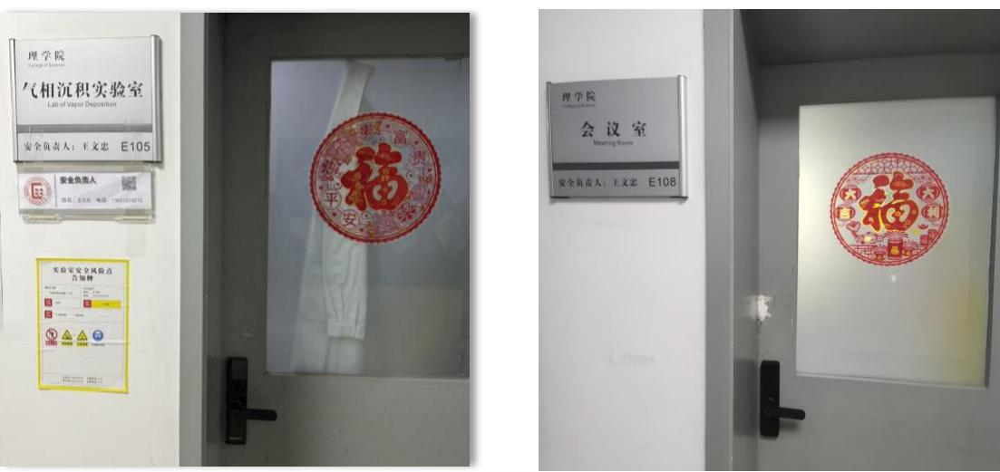

## 论实验室准入制度

所有人员进入实验室，必须完成安全培训、考核合格后方可获得准入资格，统一找蓝增宇师兄授权实验室门禁，未经培训考核者严禁进入。

进入实验室须按要求穿戴防护用品，实验服、口罩和手套，不穿拖鞋、短裤、露趾衣物，未做好个人防护禁止开展实验。

 晚上11点后不允许做实验和测试，如有特殊情况，请跟指导老师报备，且至少一人陪同。

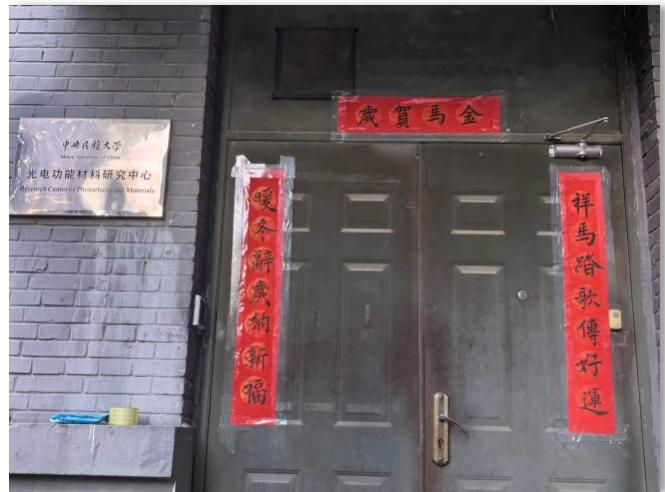

## 论实验室分工及仪器负责人员名单

东配楼实验室设备管理人员名单（2026年9月-2027年8月）

<table><tr><td>序号</td><td>工作</td><td>具体职责</td><td>现负责老师</td><td>现负责学生</td><td>现负责学生</td><td>现负责学生</td></tr><tr><td>1</td><td>京东采购+玻璃片购买</td><td>选购下单,对接开发票,整理订单 + 付款截图 + 发票。</td><td>付军丽老师</td><td>刘不凡</td><td>赵宇坤</td><td>徐永铿</td></tr><tr><td>2</td><td>新买用品的入仓库整理、买反应釜内胆、电镜室卫生</td><td>日常公用耗材(纸巾,口罩)等整理归入仓库、买反应釜及内胆,电镜室卫生</td><td>付军丽老师</td><td>王子怡</td><td>杨晋</td><td>程文超</td></tr><tr><td>3</td><td>买药品(伊诺凯等)</td><td>买药品,发票</td><td>贾莹老师</td><td>孔军超</td><td>黄雪</td><td>张文佳</td></tr><tr><td>4</td><td>核实发票</td><td>汇总发票、打印、报销</td><td>梁玉洁老师</td><td>杨洁</td><td>吴明炜</td><td>马坤</td></tr><tr><td>5</td><td>走廊门口废纸箱及时清理、会议室桌面及卫生、中屋、外屋桌面卫生</td><td>会议室桌面及卫生,实验室中屋、外屋桌面卫生</td><td>梁玉洁老师</td><td>雷凯洲</td><td>舒颖驰</td><td></td></tr><tr><td>6</td><td>录入药品及发票表格</td><td>整理发票登记表格</td><td>渠朕老师</td><td>成朗</td><td>赵宇坤</td><td></td></tr><tr><td>7</td><td>淘宝采购</td><td>选购下单,对接开发票,整理订单 + 付款截图 + 发票。</td><td>王文忠老师</td><td>黄睿</td><td>刘宗翰</td><td>苏鑫怡</td></tr><tr><td>8</td><td>走廊洗手池和下面的垃圾桶清倒</td><td>洗手池管理和走廊垃圾桶的倾倒</td><td>王文忠老师</td><td>董万峰</td><td>赵文雅</td><td>阿说依坡</td></tr><tr><td>9</td><td>管制药品采购和管理</td><td>1.各类管制药品的申请、领导审批、领取药品2.日常防爆柜的管理、钥匙的使用、用量的统计</td><td>王文忠老师</td><td>吴苏伦</td><td>韩宇飞</td><td>江承烨</td></tr><tr><td>10</td><td>三个实验室废弃物垃圾桶清倒</td><td></td><td rowspan="3">王丽娟老师</td><td rowspan="3" colspan="3">武阿芳、申亚楠、卢艺元、孙昂、乐竞业</td></tr><tr><td>11</td><td>实验废弃物分类整理、统计和集中处理</td><td></td></tr><tr><td>12</td><td>里屋实验室桌面卫生</td><td></td></tr><tr><td>13</td><td>打印机维修及墨盒采购</td><td>负责会议室及办公室打印机维修、墨盒采购</td><td>梁玉洁老师</td><td>雷凯洲</td><td>刘雨</td><td></td></tr></table>

<table><tr><td>序号</td><td>仪器存放位置</td><td>仪器名称</td><td>负责学生</td><td>备注</td></tr><tr><td>1</td><td rowspan="10">里屋</td><td>1号烘箱</td><td>申亚楠、卢艺元</td><td></td></tr><tr><td>2</td><td>2号烘箱</td><td>申亚楠、卢艺元</td><td></td></tr><tr><td>3</td><td>电子天平</td><td>雷凯洲、马坤</td><td></td></tr><tr><td>4</td><td>超声机</td><td>蓝增宇、舒颖驰</td><td></td></tr><tr><td>5</td><td>纯水机</td><td>潘崇亚、马坤</td><td></td></tr><tr><td>6</td><td>旋涂仪</td><td>潘崇亚、杨洁</td><td></td></tr><tr><td></td><td>4号、5号油浴锅</td><td>耿倩倩、吴明炜</td><td></td></tr><tr><td>7</td><td>6号、7号水浴锅</td><td>耿倩倩、吴明炜</td><td></td></tr><tr><td>8</td><td>1-5号搅拌器</td><td>雷凯洲、刘雨</td><td></td></tr><tr><td>9</td><td>通风橱</td><td>刘宗翰、赵文雅</td><td></td></tr><tr><td>10</td><td rowspan="10">中屋</td><td>3号烘箱</td><td>武阿芳、阿说依坡</td><td></td></tr><tr><td>11</td><td>干燥箱A</td><td>成朗、赵宇坤</td><td></td></tr><tr><td>12</td><td>干燥箱B</td><td>成朗、赵宇坤</td><td></td></tr><tr><td>13</td><td>真空干燥箱</td><td>王子怡、程文超</td><td></td></tr><tr><td>14</td><td>1号电化学工作站</td><td>韩宇飞、苏鑫怡</td><td></td></tr><tr><td>15</td><td>辐照计</td><td>陈家豪、吴苏伦</td><td></td></tr><tr><td>16</td><td>1号氙灯</td><td>董万峰、江承烨</td><td></td></tr><tr><td>17</td><td>光化学反应池+电极</td><td>马健琴、阿说依坡</td><td></td></tr><tr><td>18</td><td>气瓶</td><td>刘不凡、徐永铿</td><td></td></tr><tr><td>19</td><td>离心机</td><td>黄睿、江承烨</td><td></td></tr><tr><td>10</td><td rowspan="10">外屋</td><td>1号、2号水浴锅</td><td>李曼、张文佳</td><td></td></tr><tr><td>21</td><td>3号水浴锅</td><td>李曼、孔军超</td><td></td></tr><tr><td>22</td><td>2号氙灯</td><td>张康伟、徐永铿</td><td></td></tr><tr><td>23</td><td>2号电化学工作站</td><td>刘不凡、张贵</td><td></td></tr><tr><td>24</td><td>3号电化学工作站</td><td>孔军超、黄雪</td><td></td></tr><tr><td>25</td><td>4号电化学工作站</td><td>刘宗翰、赵文雅</td><td></td></tr><tr><td>26</td><td>PEC电化学测试设备</td><td>杨洁、刘雨</td><td></td></tr><tr><td>27</td><td>4号烘箱</td><td>武阿芳、孙昂</td><td></td></tr><tr><td>28</td><td>5号烘箱</td><td>王子怡、程文超</td><td></td></tr><tr><td>29</td><td>抽滤装置</td><td>陶霖、乐竞业</td><td></td></tr><tr><td>30</td><td>E103、E104</td><td>扫描/透射电镜</td><td>蓝增宇、孙昂</td><td></td></tr><tr><td>31</td><td>理工楼521</td><td>分光光度计</td><td>陶霖、乐竞业</td><td></td></tr><tr><td>32</td><td rowspan="2">理工楼318</td><td>1号管式炉</td><td>李龙荣、杨晋</td><td></td></tr><tr><td>33</td><td>2号管式炉</td><td>李龙荣、杨晋</td><td></td></tr><tr><td colspan="5">说明:1.每台设备由2名同学负责管理,包括日常规范使用提醒,设备故障及时上报并送修。2.仪器负责人包括高年级和低年级各一人,每年9月份由新生替换已毕业高年级学生。</td></tr></table>

## 论实验前的准备工作

 提前跟指导教师沟通实验方案，掌握实验目的、原理、步骤、要求；

 每组大创的每位学生和毕设学生必须由一位研究生导师全程详细指导后，方可独立操作；

 熟悉仪器的操作方法和注意事项(详见word文本)方可进行实验，重点注意事项粘贴在每个仪器上；

 搜索实验室药品清单，确定实验室是否有所需的化学药品；

 提前查明药品的基本特性：比如，易燃、易爆、剧毒、挥发性、腐蚀性等；

 有些化学药品本身不存在安全威胁，但与某些药品混合时会存在潜在的安全隐患，如$\mathsf { \pmb { A 9 } N O } _ { 3 }$ 与某些铵盐混合。

## 论管制药品使用注意事项

如需使用管制药品，请提前与负责防爆柜管理的同学预约，不可擅自使用管制药品。

使用管制药品时，即取即用，需要称量时再找到防爆柜管理的同学打开防爆柜取出药品，称量后立即归还并登记使用记录（使用记录必须填写使用量与剩余量）。

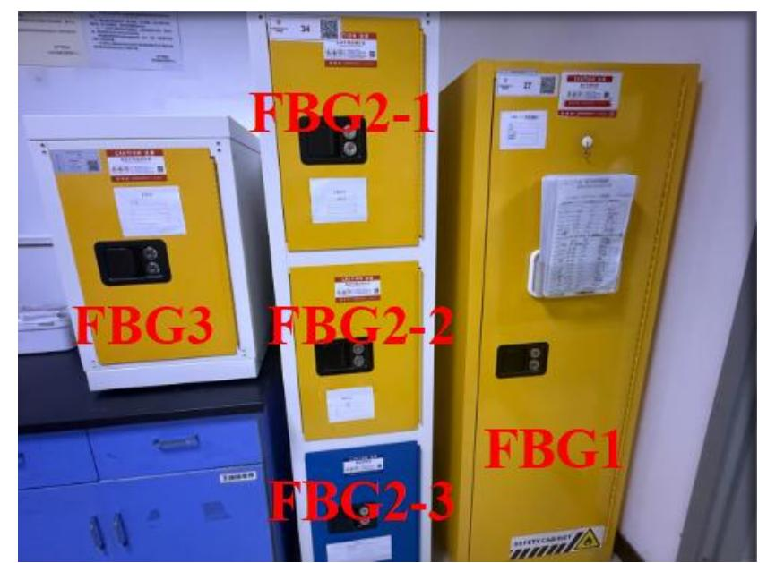

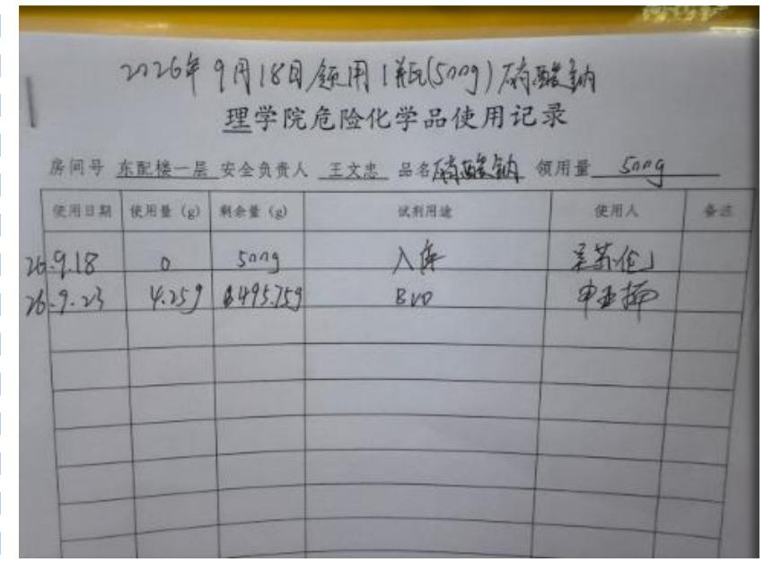

## 论普通危化药品使用注意事项

 药品购买有周期，预计还有两周余量的，要提前跟购买药品的同学预定药品

 需要使用普通危化品时，找到负责钥匙保管的同学领取钥匙即可使用，使用完及时归还钥匙。

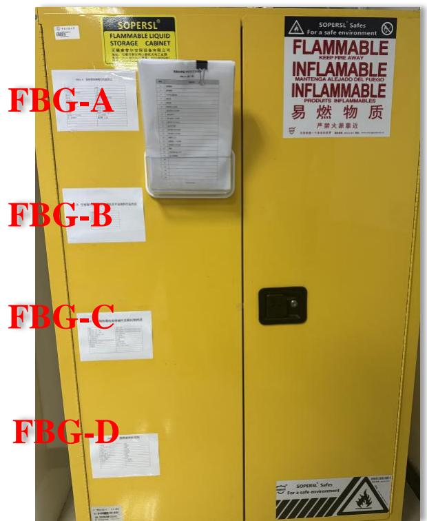

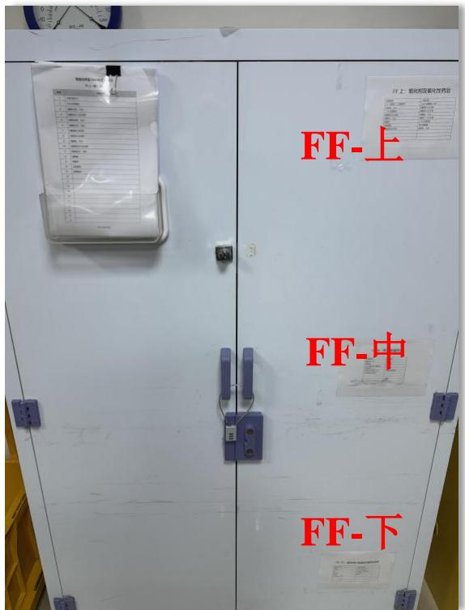

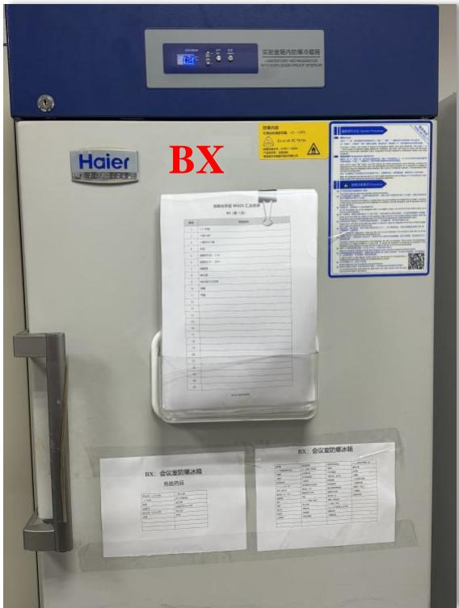

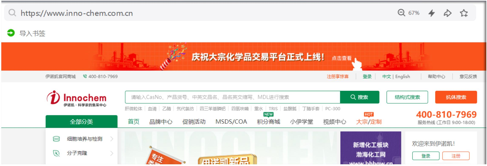

## 论化学药品购买流程

 首先确认药品库存登记表格里没有实验所需药品或只有两周余量的，需要提前预定药品。

 伊诺凯官网查找药品：https://www.inno-chem.com.cn

Qhttps://www.inno-chem.com.cn

##

## 庆祝大宗化学品交易平台正式上线！点击查看

结构式搜索

Q 搜索

抗体搜索

全部分类

## 400-810-7969

首页

品牌中心

促销活动

MSDS/COA

积分商城

小伊学堂

视频中心

服务热线(工作日9:00-18:00)

细胞培养与检测

分子克隆

伊诺凯新品

新增化工板块渤海化工网欢迎来到伊诺凯！

登录

## 论化学药品购买流程

 在伊诺凯官网搜索所需药品名称或货号等，确认药品的品牌名称以及规格。

 在药品购买的在线表格里填写所需药品信息（包含药品名称、规格、货号、所属分区等），填好后通知购买药品的负责人（孔军超）下单药品。

 药品到达之后，购买的同学尽快取出送至东配楼，然后通知药品入库的负责性能提升实例人（成朗）将药品贴上对应分区的标签后放入对应的分区。

## C区：碱和氧化物药品

M区：普通液体药品  
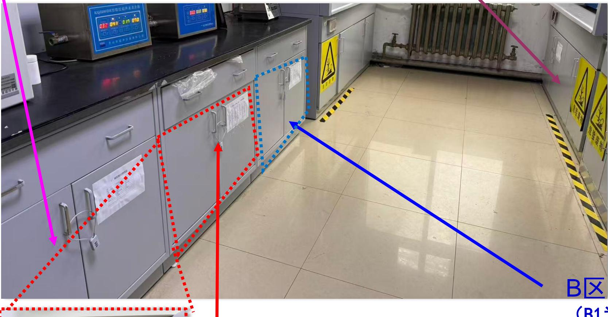

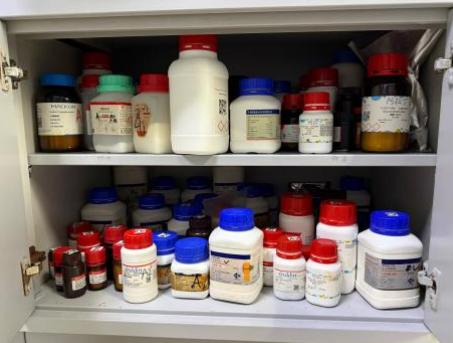

A区：无机盐（A1为钾盐、钠盐；A2为其他无机盐）

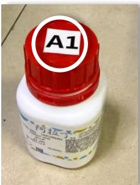

B区：固体有机盐（B1为金属有机盐；B2为非金属有机盐）

## 论实验预约的注意事项

 最多提前一周填好实验记录册，并标注为预约；

<table><tr><td>日期</td><td>实验名称</td><td>使用时间</td><td>设备用后情况</td><td>使用人</td><td>班级</td><td>使用人电话</td><td>备注</td></tr><tr><td>9.14</td><td>BVO</td><td>10:00-10:30</td><td>√</td><td>杨洁</td><td></td><td>13641293943</td><td></td></tr><tr><td>9.15</td><td>BVO</td><td>10:00-11:00</td><td>√</td><td>杨洁</td><td></td><td>13641293943</td><td></td></tr><tr><td>9.19</td><td>称量</td><td>9:00~11:00</td><td>√</td><td>邹恒富</td><td></td><td>18084381802</td><td></td></tr><tr><td>9.23</td><td> $Bi(NO_3)_2 \cdot 5H_2O$ ,  $Na_2Mo_4 \cdot 24H_2O$ ,</td><td>9:30-9:45</td><td>√</td><td>蓝增宇</td><td></td><td>18778228602</td><td></td></tr></table>

填写时注意查明同一天内他人仪器使用时间，避免实验时间发生冲突；

性能提升实例 XRD自行预约，本科生经研究生指导后可操作；分光光度计、SEM和PEC测试需要由通过考核的师兄师姐预约和操作。

## 论实验中的注意事项

 饮料、食品不得带入实验室；

 实验期间不得打闹、大声喧哗、看手机、视频等；

 必须穿实验服、戴口罩、手套（分大中小号）；

 化学实验和取反应釜必须在通风柜中操作，把通风柜的玻璃拉到尽可能低；

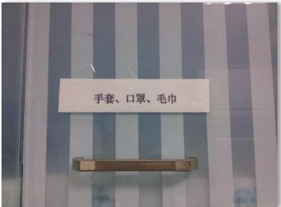

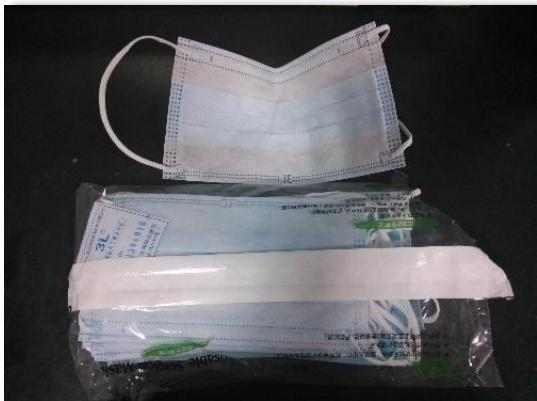

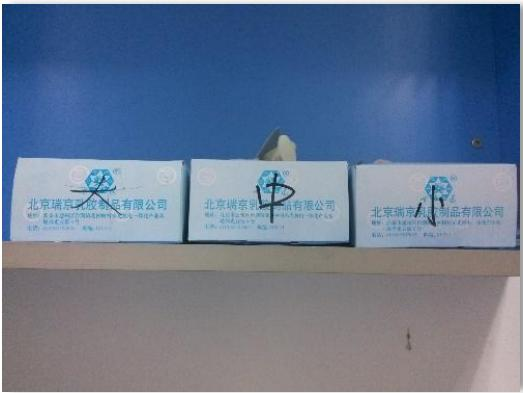

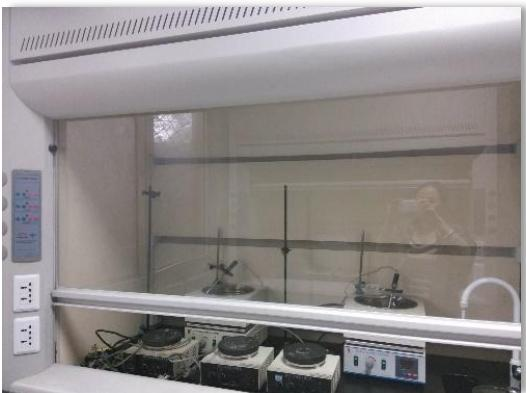

 实验中发现药品量不足时，至少提前两周跟指导教师或者实验室药品负责人预定；

 在每个实验仪器使用记录本上做好详细的实验登记，包括日期、时间、使用人、手机号码等；

<table><tr><td>日期</td><td>实验名称</td><td>使用时间</td><td>设备用后情况</td><td>使用人</td><td>班级</td><td>使用人电话</td><td>备注</td></tr><tr><td>9.14</td><td>BVO</td><td>10:00-10:30</td><td>√</td><td>杨洁</td><td></td><td>13641293943</td><td></td></tr><tr><td>9.15</td><td>BVO</td><td>10:00-11:00</td><td>√</td><td>杨洁</td><td></td><td>13641293943</td><td></td></tr><tr><td>9.19</td><td>称量</td><td>9:00~11:00</td><td>√</td><td>邹恒量</td><td></td><td>18084381802</td><td></td></tr><tr><td>9.23</td><td> $Bi(NO_3)_2 \cdot 5H_2O$ ,  $Na_2Mo_4 \cdot 2H_2O$ ,</td><td>9:30-9:45</td><td>√</td><td>蓝增宇</td><td></td><td>18778228602</td><td></td></tr></table>

 仪器出现故障，及时跟指导教师汇报，并在设备用后情况一栏写明故障情况；

 需要暂时搁放的样品要用标签纸写明姓名、电话和成分，放在规定地方，记住及时处理。

## 论实验结束的注意事项

 实验产生的重金属、酸碱等废液回收到指定的瓶中（含卤有机物，无卤有机物等）

 及时关闭所用仪器电源，拔下磁力搅拌器的插头并将搅拌速率调到0；

结论 整理所用过的玻璃器皿等物品，及时超声清洗并放回原处,擦净实验台；

 每天最后离开实验室的同学需确认仪器状况、关闭通风橱、关灯、关两个实验室的门、药学院联通的门和东西两个大门。

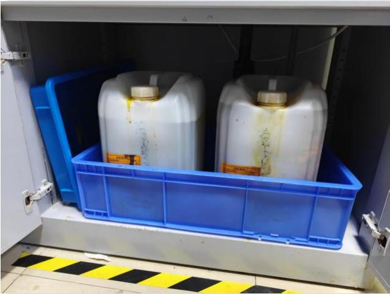

## 论实验结束的注意事项

##  垃圾放到指定位置

只允许扔不沾染 验用品外包装和纸巾 药品的实验用品 外包装和纸巾

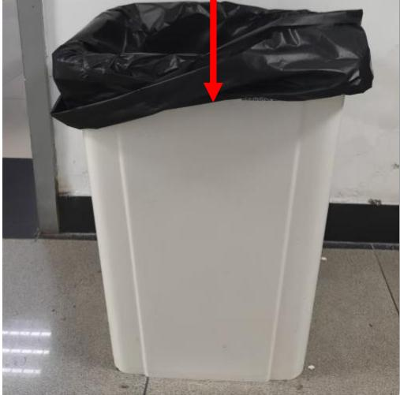  
走廊垃圾桶

称量纸、滤纸、纸巾类 橡胶手套 胶头滴管、离 心管、针筒

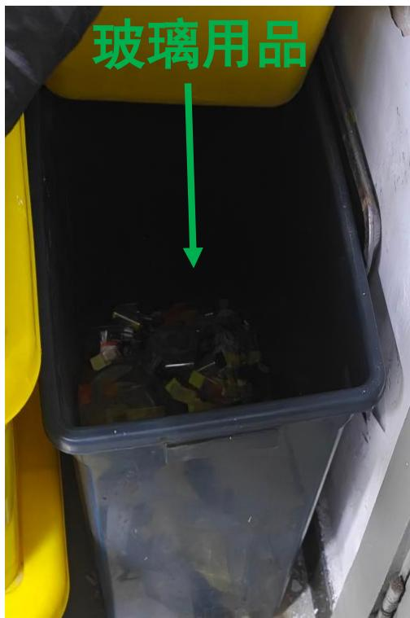  
外屋垃圾桶

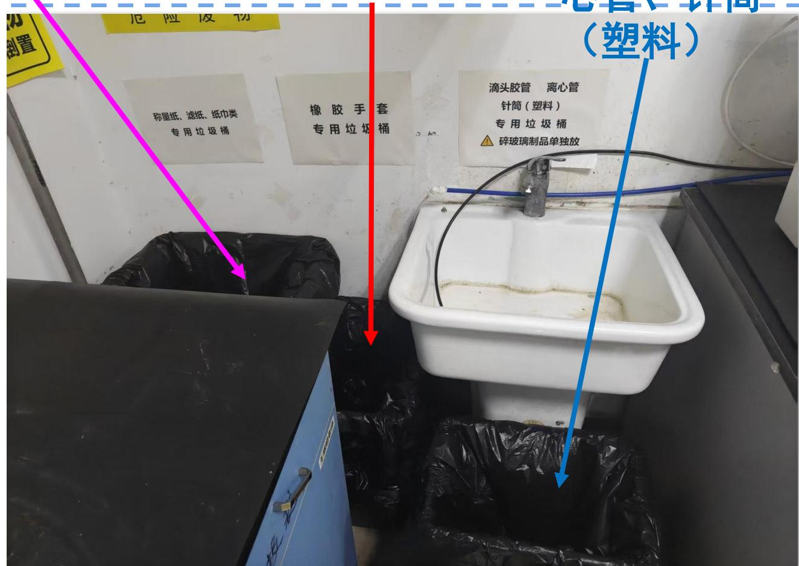  
实验室里屋垃圾桶

## 二、常用仪器使用注意事项

## 电子天平

##  不要挪动天平；

 称量纸对折，使被称量物集中置于称盘正中位置；

 称重量较大的，比如配置电解液可能用称量舟，用后及时清洗；

 节约试剂，每次少量称量，多余试剂不能倒回试剂瓶，放回废液瓶；

 药品尽量避免撒落在天平里。万一撒落，千万不要直接用洗耳球或嘴吹，用小刷子处理。棉签蘸少量中性清洗剂（肥皂）或性能提升实例酒精擦洗，不要让液体渗到仪器内部，再用棉签或者纱布擦干；

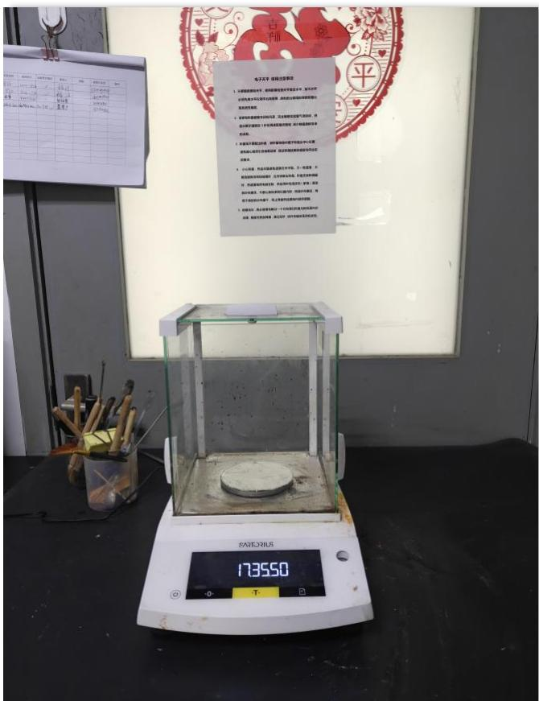

 实验结束后及时用纱布蘸中性清洗剂或酒精把桌面上天平周围撒落的试剂擦干净。

## 论纯水机

 RO为去离子水出水口，UP为超纯水出水口，一般实验用去离子水即可。

 轻触按键即可，不可用力按压。

能 实例 若指示灯出现闪烁及时上报。

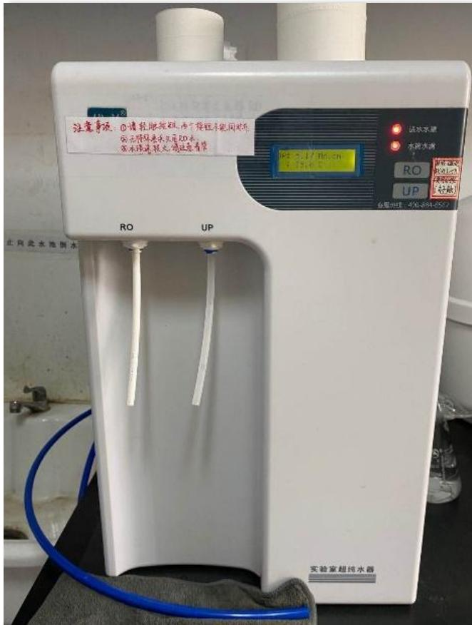

## 论恒温磁力搅拌器

从台子旁边将带磁子的烧杯进行移动，不要碰到其他烧杯；

根据溶液多少和磁子大小进行调速；

随时观察搅拌情况调整转速和烧杯位置；

使用完毕后转速调零，关闭电源。

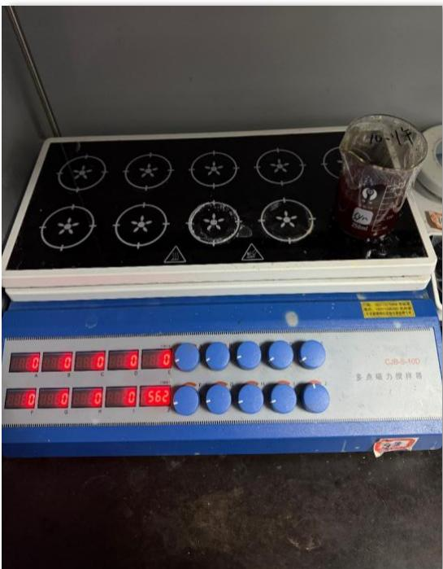

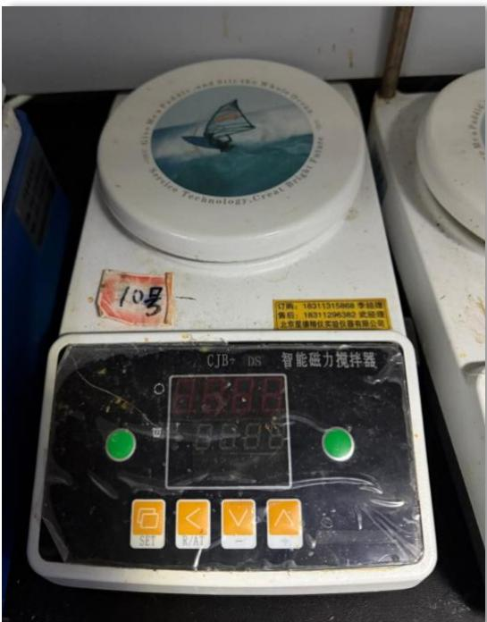

## 论超声清洗器

 将需要清洗的物品放入清洗网架中，把清洗网架放入清洗槽内，绝对不能将物件直接放入清洗槽内，以免影响清洗效果，同时会损坏仪器；

 离心管、滴管等需要清洗的物品一定要先放入盛水的烧杯里，不能直接放入清洗槽；

 水温低于20 ℃时，需先加热提高水温，再清洗；低于水位线时需先加入水再使用。

 清洗槽内的水要及时更换，需关电源。

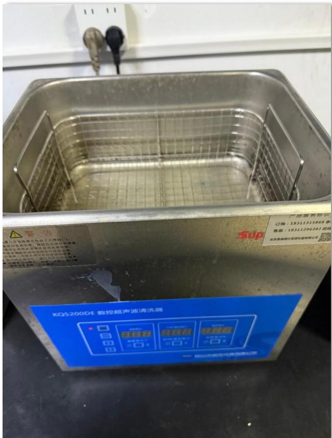

## 反应釜

 反应釜钢壳和内胆 “一釜一衬，盖体成套，”禁止新旧交替、釜釜混合使用；

 装料原则：最大装料不得超过内胆容积的70%，并据具体反应体系进行调整，一般为20%\~50%，遵循温度越高容积率越低的原则；

 密封过程：将反应物加入内胆中，盖好内胆上盖、正确放置釜底部下垫片(凸起面向下)，并将内胆外壁擦拭干净，放入反应釜外壳中，内胆顶部放入上垫片(两面纯平)，先缓慢将釜盖和釜体的螺纹丝口对接，再手动拧紧，然后用紧固杆或扳手配合台钳进一步紧固到最佳密封状态；

反应完成后，务必等待反应釜自然冷却至室温后(内部压力接近常压)，再将反应釜转移至通风橱进行开釜操作，严禁采用直接冲水或者冰浴等急速冷却方式；

 反应釜使用后外壳和内胆及时清洗，并放置于通风干燥环境中晾干，以免锈蚀和污染。

 内胆在高温高压使用过程中损耗不可避免，如污染严重或出现明显形变，请及时更换。

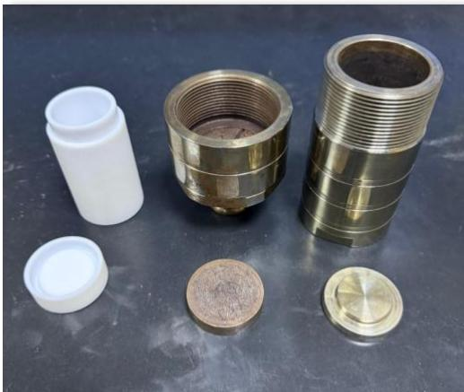

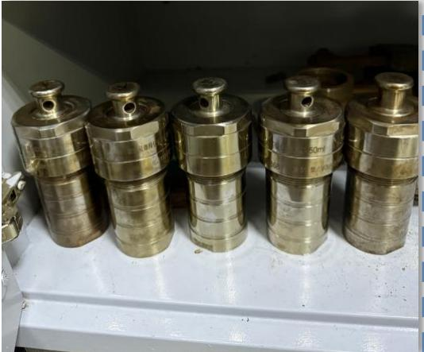

## 恒温干燥箱

 恒温干燥箱A、B做烘干用，烘干温度 $60 \%$ ，其余干燥箱作反应用，最高不超过 $2 2 0 \%$

 如果干燥箱中有样品正在加热或烘干中，请不要随意更改温度；

 记录好加热或烘干停止的时间，及时取出样品；

 干燥箱内部严禁放置纸张类易燃物品，不得摆放在箱体的最下层区域，防止塑料制品、纸张等直接接触高温引发融化、起火等安全隐患。

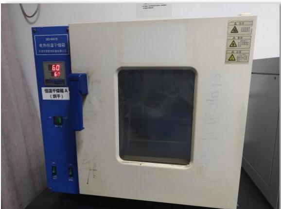

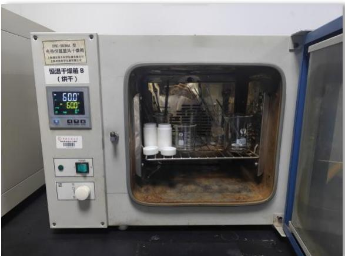

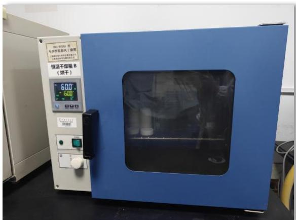

## 论真空干燥箱

 先抽真空再升温，不可以升温后再抽真空，以免影响样品，同时也会损坏仪器；

 开机：关门 – 关放气阀 – 关真空阀 – 开真空泵 – 开真空阀 – 抽真空；

 真空指针在表盘的绿色范围内越低表示空气越稀薄，样品氧化程度越低；

 关机：关加热 – 降温 – 关真空阀 – 关真空泵– 开放气阀；

 真空结束后需要等待几分钟再开门。

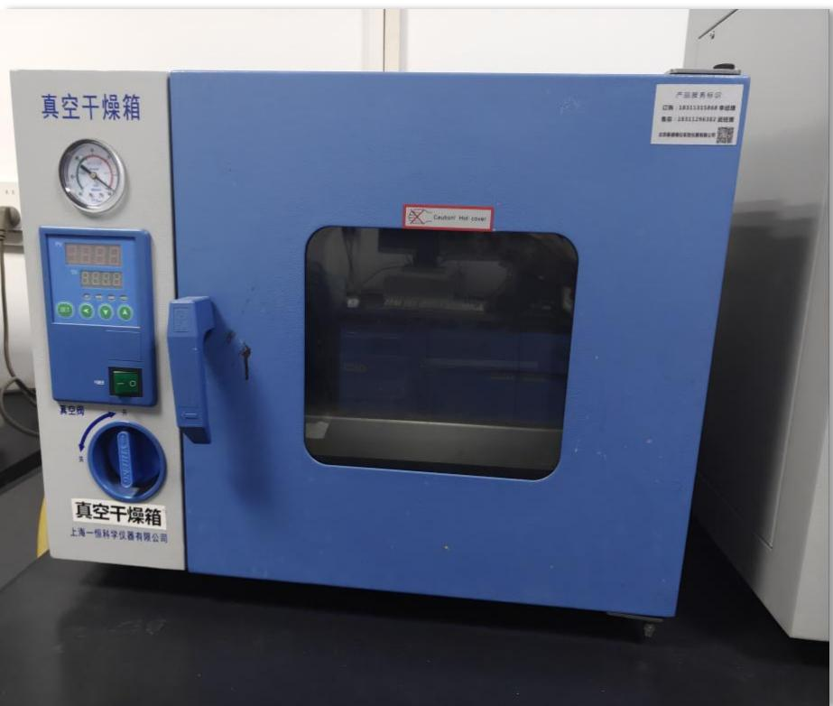

## 论高温管式炉

 升温速率最高为8 ℃/min，不能升温过快；

 不要在运行过程中修改控温程序，如需更改，可先停止程序运行再修改；

 管式炉升温过程中，必须留人看守；恒温过程每2小时要查看一次，恒温结束后，必须检查是否正常降温。

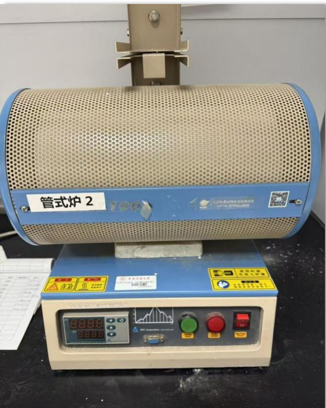

## 论水（油）浴锅

使用前务必确认好锅内的液体淹没过加热管；

水浴锅最高温度不能超过100 ℃，论油浴锅最高不能超过 $2 6 0 \%$ ；

油浴锅内不能进水；

反应时间较长时，每隔2小时需查看，反应结束及时取出。

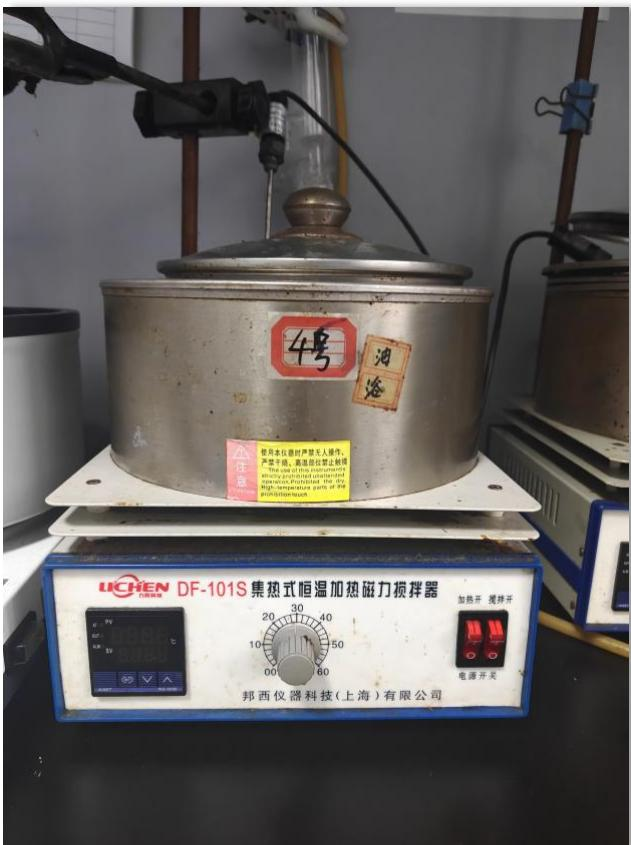

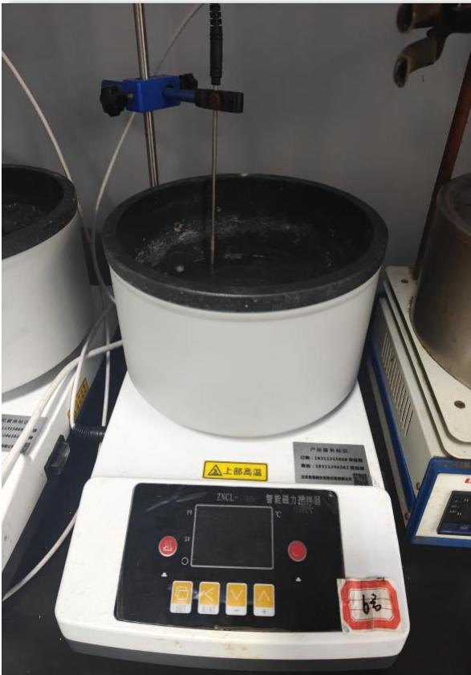

## 论旋涂仪

 按照实验要求设置低速和高速的速率和时间；

 机器运转期间不可调整任何按钮；

 每次使用完毕后，需清理干净。真空口必须用乙醇进行清洗，若有堵塞物时，可滴加丙酮清洗。

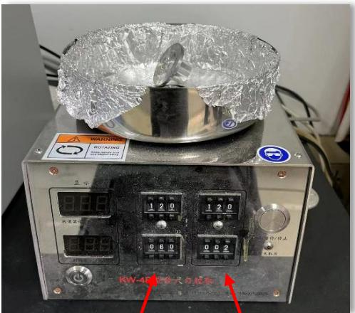  
低速 高速

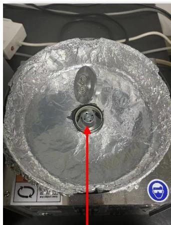  
清洗

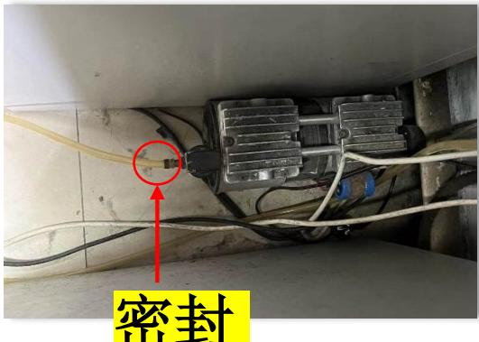  
密封

## 论离心机

 离心样品等量灌注，盖紧，对称放置，不足八个样品用等量的水填充，防止机身振动；

 根据样品特点选择合适的转速和时间，转速不超过8000转/分钟；

 在离心过程中，操作人员不得离开，如有巨大噪音或机身振动时，不要直接关掉电源，先按“停止”使转子慢慢停下，再关闭电源，排除故障。

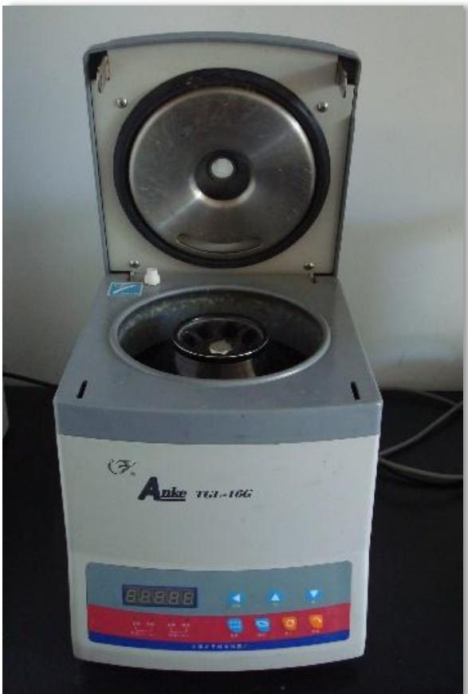

## 论X射线衍射仪

##  升压和降压一定严格按照程序缓慢进行;

 开、关门时必须小心轻拉，扫描前一定把门关严;扫描角度20-80 ℃，若有特殊需要必须经老师同意并现场指导方可进行;

 每次更换样品后，点击“测角仪”工具栏中的“校读”按钮，校准初始位置，然后测量下一个样品。

 实验结束后，必须及时把钥匙放回研究生办公室里。

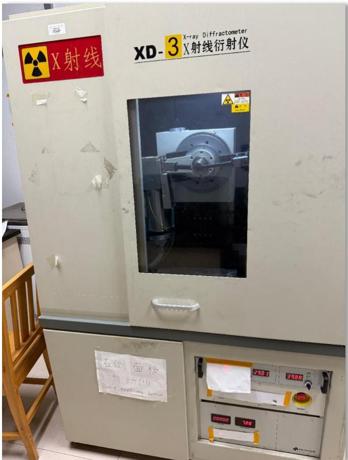

## 论电化学工作站沉积

 分清电极：绿色接铂片电极夹，白色接参比电极，红色接铂丝；

 铂片电极夹不能浸入液体中，若浸入液体，先用去离子水冲洗再吹干；

性能提升实例 机器预热，注意开关机顺序。

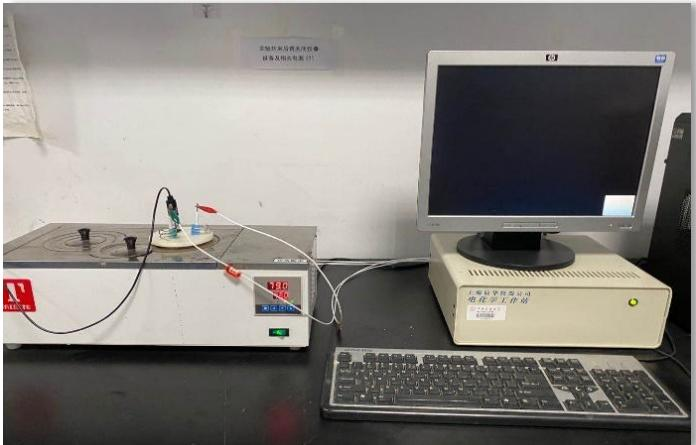

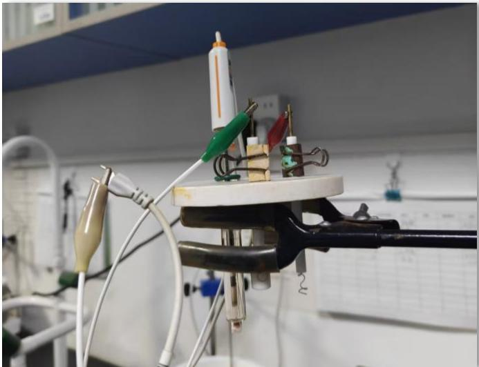

## 论电化学工作站测试

分清电极：绿色接铂片电极夹；白色接参比电极；红色接铂丝；

 铂片电极夹不能浸入液体中；若浸入液体，先用去离子水冲洗再吹干；

先将氙灯和工作站预热，调整电解池至合适光强位置；

测试完毕，关机，散热，二十分钟后盖上防尘布。

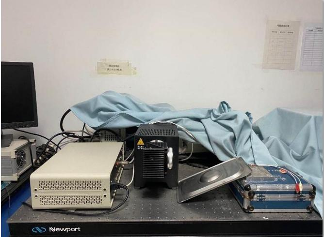

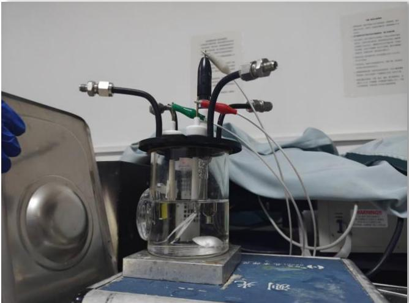

## 论扫描电子显微镜

 通过考核的研究生方可操作；

 测试时间最晚到晚上八点；

 样品台高度调整合适；

 导电胶适量，根据样品而定；

 严格按步骤进行操作，手不可触碰仪器内部的任何部位；

 尤其注意推样杆的位置。

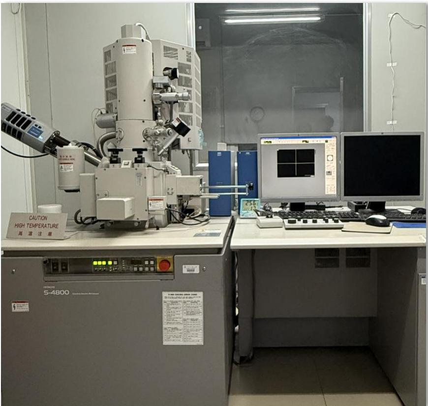

## 论紫外可见分光光度计

 通过考核的研究生方可操作；

开机稳定5 min后使用;

开、关仪器门，更换积分球的时候必须小心；

严格按照操作步骤，不可随意更改程序数据；

使用完毕后，先关闭软件再关闭仪器；

所用比色皿必须及时清理干净。

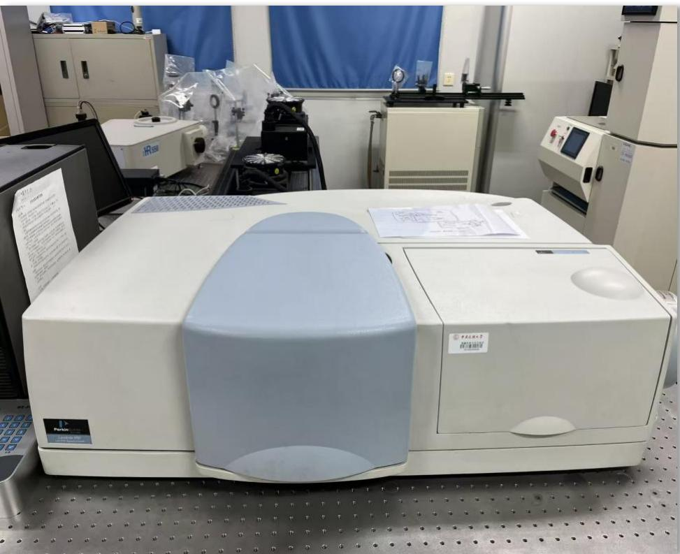

## PL光致发光测试系统

## 显微共聚焦拉曼光谱仪

## 由导师或者会操作的师兄师姐操作测试

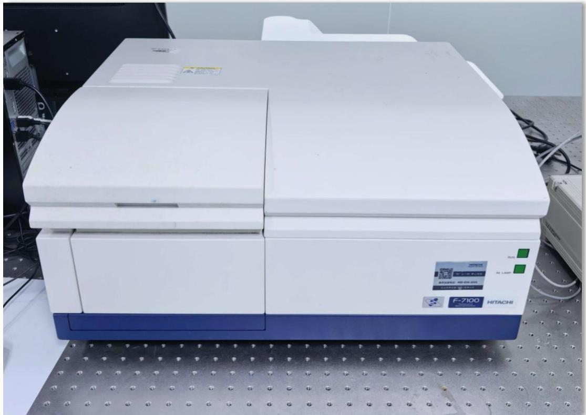

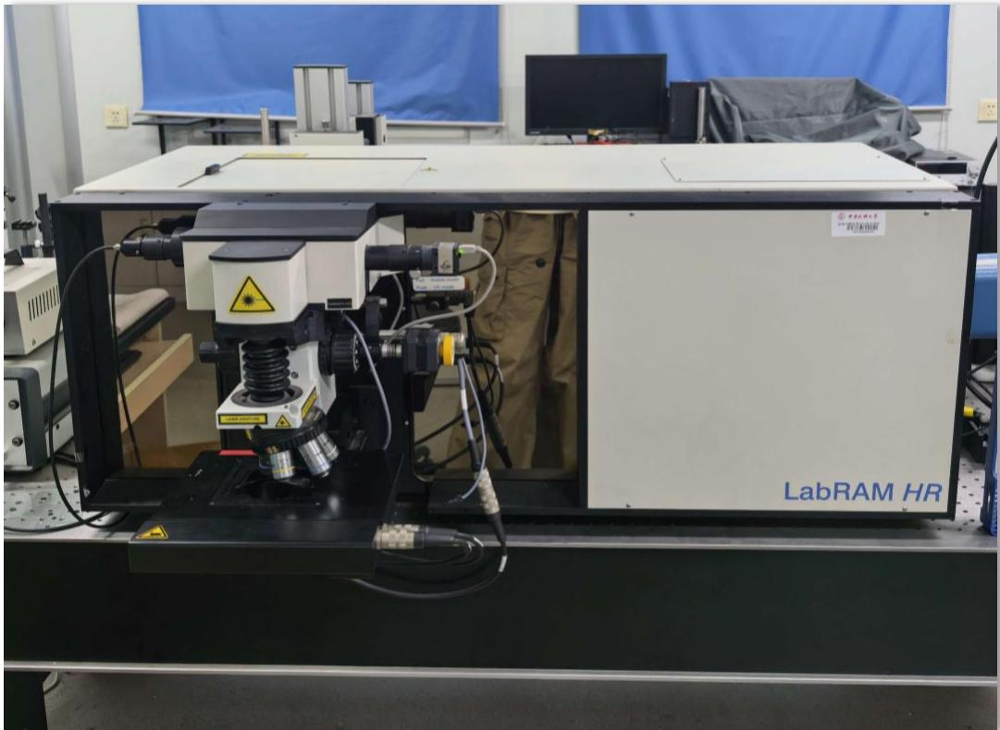

## 三、实验室日常管理制度

 每日由负责老师开展实验室例行检查，检查发现的问题于当日 9:30 前发布至日常管理群，全体人员须及时关注群内信息并回复；规定时限内回复的罚值日 1 次，超时回复的罚值日 2 次，未回复且经监控核实的，罚值日 3次并暂停实验权限两周。

 实验过程中发现仪器设备故障须第一时间向老师报备；发现故障未及时报备、或后续使用时查实上一位使用者未履行报备义务的，均罚值日 3 次暂停实验权限两周。

 按实验室卫生与安全的分工情况，各小组负责对应区域及专用设备（如扫描电镜等）的清洁维护，每周至少组织 1 次集中卫生清扫。

## 谢谢大家的支持和配合！