## **目录**

## **0   目  录**

**第一章 X-射线晶体学简介**

**第二章 晶体学基础**

**第三章 X-射线衍射基础**

**第四章 实验技术**

**第五章 数据基本处理和物相分析**

**第六章 单胞的确定**

**第七章 晶体结构解析**

**第八章 晶体结构精修**

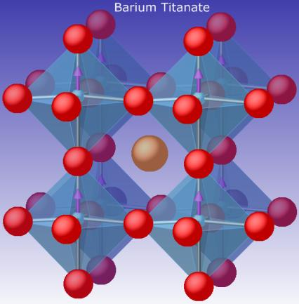

## **第三章   X-射线衍射基础**

## **3  X-射线衍射基础**

—— 为什么用X射线

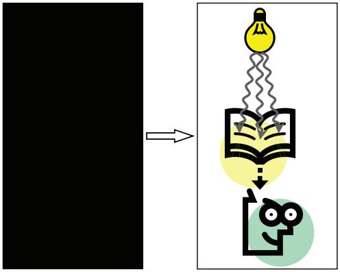

### **入射光**

### **样品**

### **探测器**

## **第三章   X-射线衍射基础**

## **3  X-射线衍射基础**

—— 为什么用X射线

X-射线是种波长约为0.1-100 Å的电磁波；

晶体学中所需波长为：0.5-2.5 Å， why？

大多数有机物/无机物的键长都在这个范围!

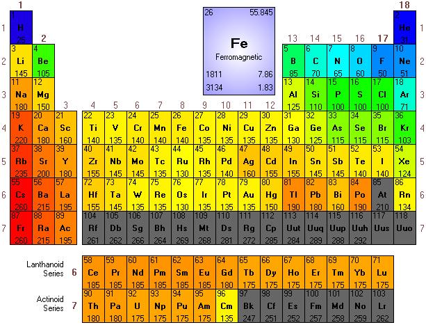

## **第三章   X-射线衍射基础**

## **3  X-射线衍射基础**

—— 为什么用X射线

**X-射线具有很强的穿透性：**

安全！如何防范？

与样品的相互作用较弱 → 需要长时间收集数据；

与样品相互作用较弱，通常不用考虑吸收效应，也不用考虑动力学效应 → 分析比较简单。

## **第三章   X-射线衍射基础**

## **3  X-射线衍射基础**

—— 如何产生X射线

### **X射线光管的结构**

### **发射电子**

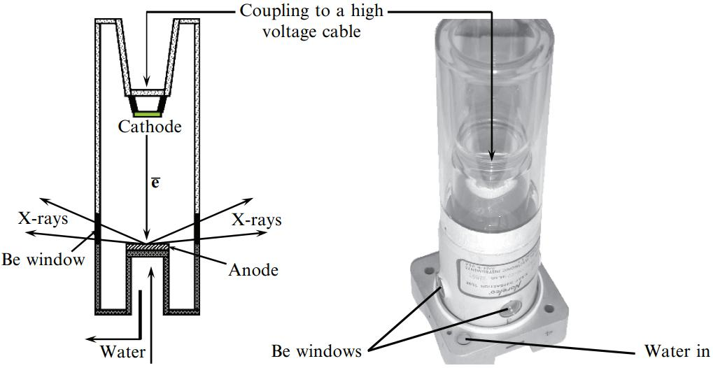

## **第三章   X-射线衍射基础**

## **3  X-射线衍射基础**

—— 如何产生X射线

**X射线光管的特点**

高能电子轰击阳极靶产生X-射线

特点：效率低、亮度低

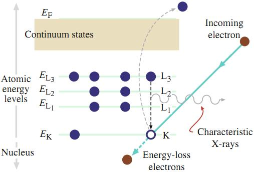

高能电子的能量→热能

## **第三章   X-射线衍射基础**

## **3  X-射线衍射基础**

—— 如何产生X射线

### **不同靶子的X射线**

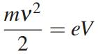

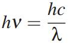

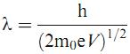

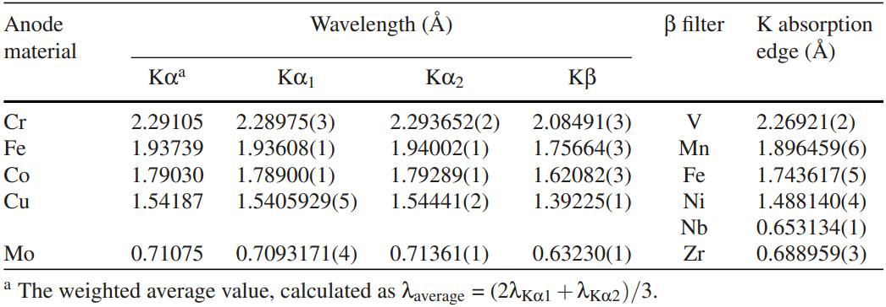

## **第三章   X-射线衍射基础**

## **3  X-射线衍射基础**

—— 如何产生X射线

### **X射线的命名**

主量子数：K、L、M、N、O、P

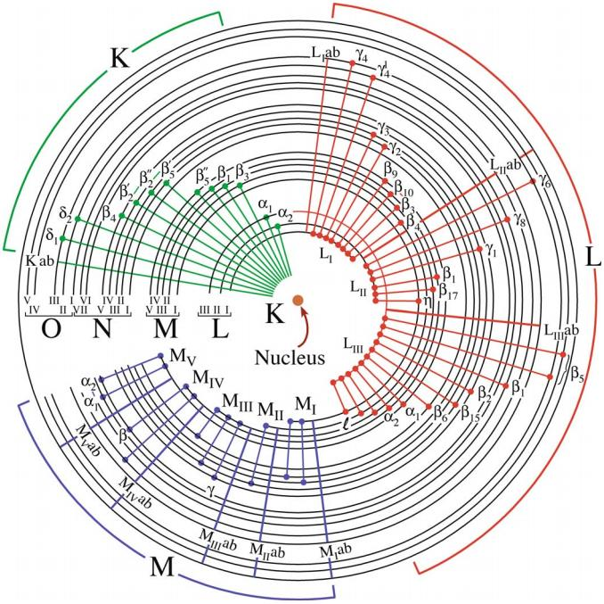

除K壳层外，都有子壳层，L1、L2……

L壳层：Kα

K壳层

M壳层：Kβ

M壳层：Lα

L壳层

N壳层：Lβ

最外子壳层：下标1

次外子壳层：下标2

## **第三章   X-射线衍射基础**

## **3  X-射线衍射基础**

**——  X-射线的产生**

——X射线的特征

### **X射线的命名**

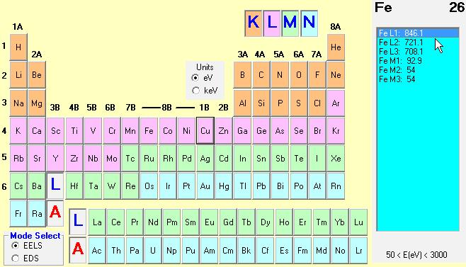

## **第三章   X-射线衍射基础**

## **3  X-射线衍射基础**

——X射线的特征

### **铜靶X射线的特征**

### **2p1/2→1s1/2**

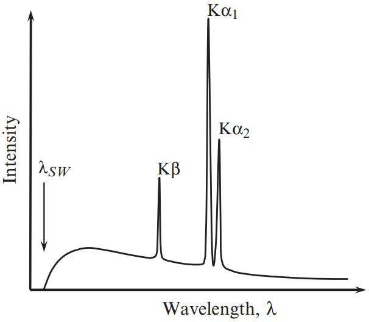

Ikα1\~2Ikα2\~5Ikβ

### **L→K**

### **M→K**

### **2p3/2→1s1/2**

连续背底：韧致X-射线

## **第三章   X-射线衍射基础**

## **3  X-射线衍射基础**

——X射线的特征

### **铜靶X射线的特征**

### **白色光**

### **很高的背底**

### **单色器**

### **3个特征峰**

### **3个衍射峰**

### **各方向的角发散度不一样**

### **准直器**

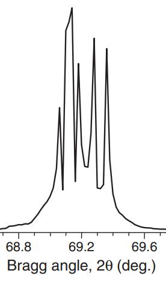

峰重叠问题

## **第三章   X-射线衍射基础**

## **3  X-射线衍射基础**

——X射线的校正

单色器 Monochromatization

β滤波片：选择性吸收Kβ峰，只让Kα1和Kα2透过。

**β-filter**

要求滤波片的原子序数要比阳极靶的小

Cu靶通常用Ni滤波片；Mo靶常用Nb和Zr滤波片。

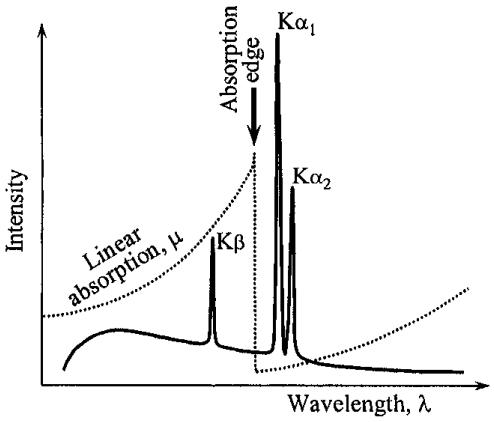

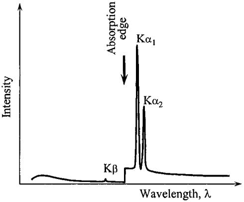

## **第三章   X-射线衍射基础**

## **3  X-射线衍射基础**

——X射线的校正

单色器 Monochromatization

### **原理：高质量单晶的Bragg衍射**

### **出射光的能量明显降低**

### **仅取旁轴光**

### **对入射光有“选择性的放大”**

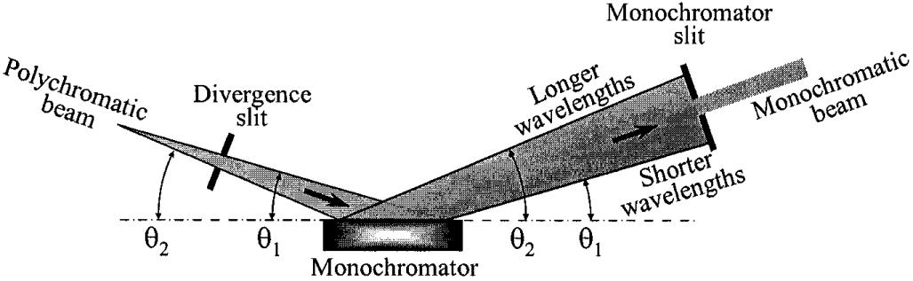

## **第三章   X-射线衍射基础**

## **3  X-射线衍射基础**

——X射线的校正

准直器 Collimation

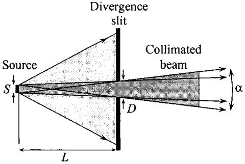

### **焦斑(mm)**

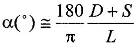

### **Divergent slit**

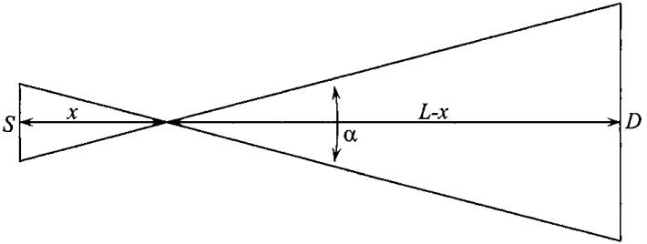

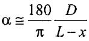

## **第三章   X-射线衍射基础**

## **3  X-射线衍射基础**

——X射线的校正

准直器 Collimation

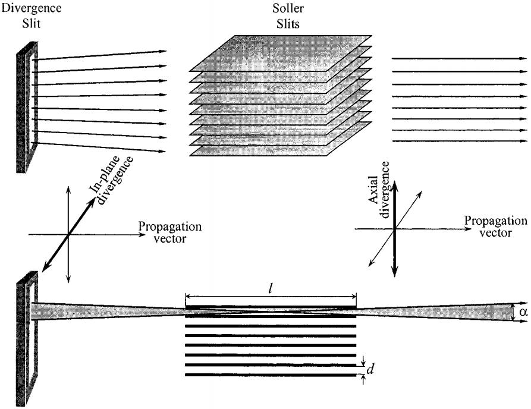

### **Divergent slit：减小面内发散度；**

### **Soller slit：减小轴向发散度。**

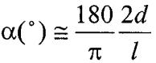

## **第三章   X-射线衍射基础**

## **3  X-射线衍射基础**

——X射线的探测

### **探测器的性能参数**

### **detector**

### **量子效率：探测信号/输入信号**

### **噪声水平：由非输入信号造成的信号输出；值越小越好;**

### **动力学范围：可探测最强信号/平均噪声基准，值越大越好；**

### **死时间：探测器吸收光子、光子→脉冲、探测器重置所需的时间，越短越好；**

### **灵敏度：输出可探测信号时所需最少的接收到的光子数；**

### **能量分辨率：分辨不同波长光子的能力，常用半高宽表示。**

## **第三章   X-射线衍射基础**

## **3  X-射线衍射基础**

——X射线的探测

### **探测器的种类**

### **胶片：曝光、显影、定影、冲洗，还需数字化，麻烦!**

### **闪烁晶体计数器：**

### **X射线**

### **可见光**

### **电子**

### **电子**

### **闪烁**

### **晶体**

### **光阴极**

### **光电**

### **倍增管**

## **第三章   X-射线衍射基础**

## **3  X-射线衍射基础**

——X射线的探测

### **探测器的种类**

### **要求闪烁晶体具有：**

### **对X射线有高吸收系数；**

### **能高效率的把X射线光子转换为可见光光子；**

### **该可见光光子的波长与光阴极材料所需波长匹配；**

### **闪烁间隔尽量短。**

### **易潮解**

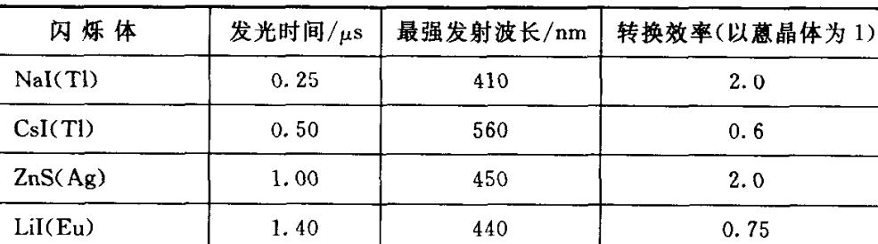

### **最常用**

## **第三章   X-射线衍射基础**

## **3  X-射线衍射基础**

——X射线的探测

### **探测器的种类**

### **固体探测器实际上就是半导体二极管；**

### **PN结两端所形成的电压：**

### **P型区**

### **耗尽层**

### **N型区**

### **能量分辨率较高；**

### **适用波长范围广；**

### **最大计数率小，易饱和；**

### **必须在低温下运行。**

### **X-ray**

### **PN结二极管**

## **第三章   X-射线衍射基础**

## **3  X-射线衍射基础**

——X射线的探测

**探测器的种类**

其它探测器：

位敏探测器(Position Sensitive Detector)

成像板(image plate)

CCD (Charge Coupled Device)

## **第三章   X-射线衍射基础**

## **3  X-射线衍射基础**

——X射线衍射原理

### **X射线是种电磁波，是交变振荡的电磁场；**

### **X射线入射到晶体上，构成晶体的原子内的电子会在交变电场的作用下振荡；**

交变电场迫使电子加速、减速（同频振荡），变化的电场 → 变化的磁场

### **振荡的电子向四周发射电磁波，即将入射点电磁波向四周散射；**

### **这些散射波与入射波具有相同的频率，是相干的；**

### **晶体具有周期性→周期性散射源具有相同的位相差，有很强的干涉效应→衍射现象。**

## **第三章   X-射线衍射基础**

## **3  X-射线衍射基础**

——X射线衍射原理

**X射线在晶体中的散射**

**1D**

atomic scattering factor

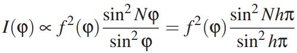

**3D**

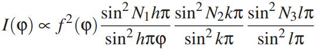

hkl：晶面指数，定义衍射面的相对位置

N1、N2、N3：定义3D方向上的原子数或单胞数

## **第三章   X-射线衍射基础**

## **3  X-射线衍射基础**

——X射线衍射原理

Braggs’Law

W. H. Bragg and W. L. Bragg

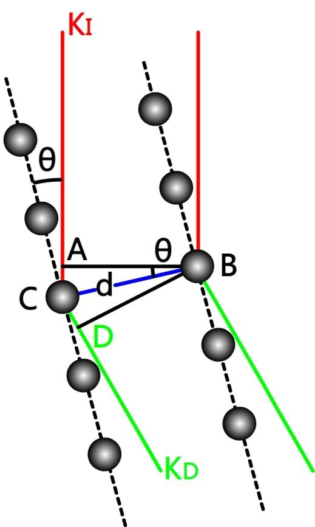

X射线(或其它射线)以θ角入射到原子面上，则入射波和出射波之间存在波程差 (path difference) 为：

AC+CD

仅当入射波和出射波的位相一致时，才出现强烈的散射作用，

AC+CD=2dsinθ=nλ

该公式给出晶面间距-衍射角-波长间的关系

## **第三章   X-射线衍射基础**

## **3  X-射线衍射基础**

——X射线衍射原理

在K空间中的描述

### **Bragg散射是种弹性散射，散射过程中电子的能量保持守恒：**

### $\left|\boldsymbol{\mathit{K}}_{\boldsymbol{\mathit{I}}}\right|=\left|\boldsymbol{\mathit{K}}_{\boldsymbol{\mathit{D}}}\right|=\frac{\mathbf{1}}{𝝀}$

### **根据入射波和散射波的矢量关系，可得：**

### $\boldsymbol{\mathit{s}}\boldsymbol{\mathit{i}}\boldsymbol{\mathit{n}}𝜽=\frac{\left|\boldsymbol{\mathit{K}}{|}/{\mathbf{2}}\right.}{\left|\boldsymbol{\mathit{K}}_{\boldsymbol{\mathit{D}}}\right|}$

### $\left|\boldsymbol{\mathit{K}}\right|=\frac{\mathbf{2}\boldsymbol{\mathit{s}}\boldsymbol{\mathit{i}}\boldsymbol{\mathit{n}}𝜽}{𝝀}$

### $\left|\boldsymbol{\mathit{K}}\right|=\frac{\mathbf{2}\mathbf{s}\mathbf{i}\mathbf{n}𝜽}{𝝀}=\frac{\mathbf{1}}{\boldsymbol{\mathit{d}}}=\boldsymbol{\mathit{g}}$

### **该公式给出了衍射矢量g和晶面间距d间的基本关系**

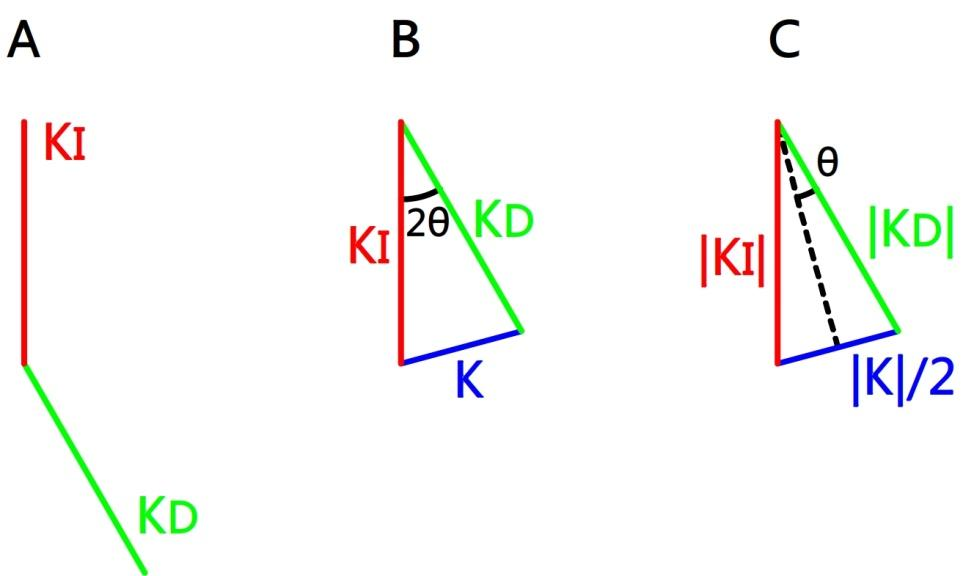

## **第三章   X-射线衍射基础**

## **3  X-射线衍射基础**

——X射线衍射原理

在K空间中的描述

- 过晶体点阵原点C作一半径为1/λ的球(Ewald sphere)。其中OC为入射波KI，衍射波为KD，仅当倒易杆与Ewald球面相截时才满足Bragg定律，才会出现强烈的散射现象。

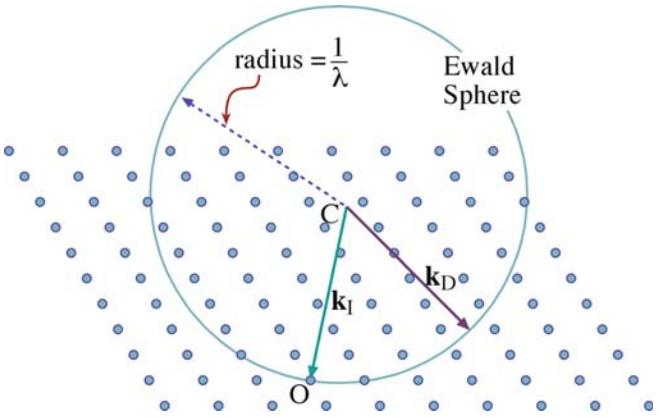

### **K**

## **第三章   X-射线衍射基础**

## **3  X-射线衍射基础**

——X射线衍射原理

在K空间中的描述

入射X-射线定义Ewald球；

Ewald球和倒易格点相切

K=g=1/d

满足Bragg衍射角2θ

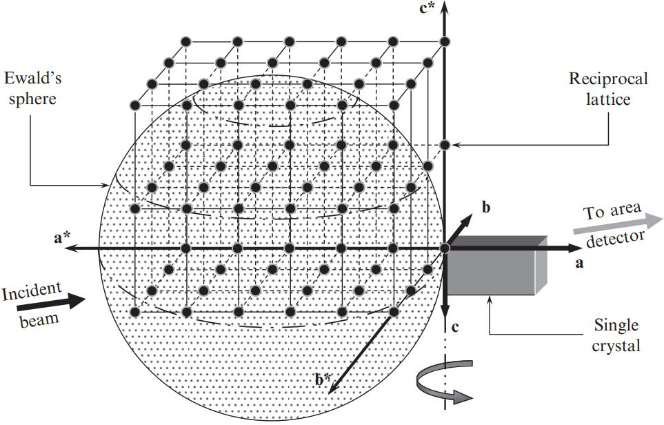

## **第三章   X-射线衍射基础**

## **3  X-射线衍射基础**

——X射线衍射原理

### **多晶：由空间取向完全随机的无数小晶粒/单晶组成**

### **每个晶体的倒易点阵都是相同的，但在空间取向分布是随机的；**

### **同一个K矢量/晶面间距d在空间是均匀分布的，构成以原点为球心，K矢量为半径的球壳(倒易球壳)；**

### **倒易球壳与Ewald球相割为一圆，圆上任意点都会出现明显衍射；**

### **由原点到圆周上的点构成衍射锥，圆锥半顶角为Bragg衍射角2θ。**

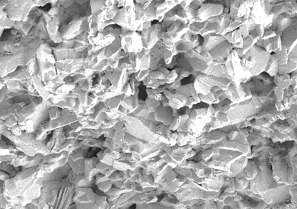

## **第三章   X-射线衍射基础**

## **3  X-射线衍射基础**

——X射线衍射原理

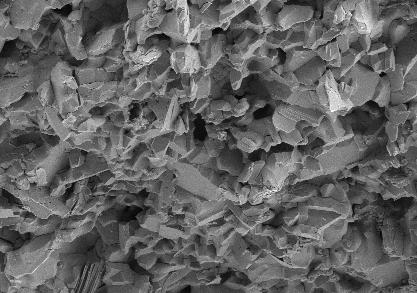

### **X-ray**

### **λ**

### **1/λ**

### **K**

### **衍射球壳**

### **衍射锥**

### **二维衍射花样**

## **第三章   X-射线衍射基础**

## **3  X-射线衍射基础**

——X射线衍射原理

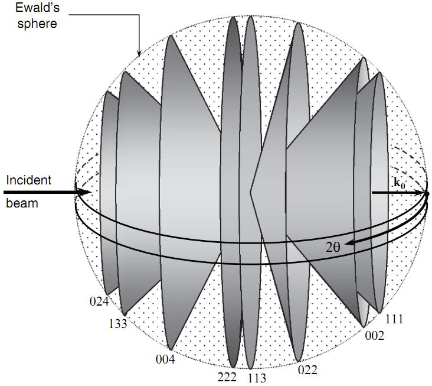

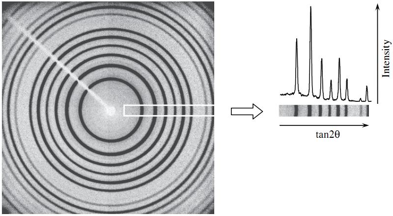

## **第三章   X-射线衍射基础**

## **3  X-射线衍射基础**

——X射线衍射的表示

### **通常实验所得的衍射数据是衍射角度和计数率的函数**

### **在正式场合绝对不允许拷屏，需用origin等专业绘图软件画图！**

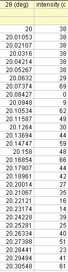

### **1) 按科技论文规范绘图**

### **2）能绘制多曲线图**

### **3）能绘制含PDF卡片的多曲线图**

### **4）能转换不同波长的数据**

## **第三章   X-射线衍射基础**

## **3  X-射线衍射基础**

——X射线衍射的表示

### **要想显示强峰下的弱峰？**

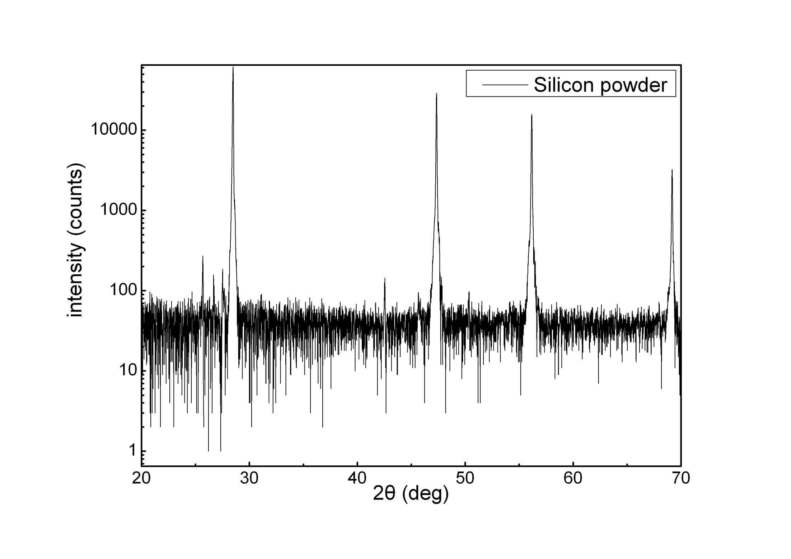

Logarithm of intensity

### **杂相、超结构？**

## **第三章   X-射线衍射基础**

## **3  X-射线衍射基础**

——X射线衍射的表示

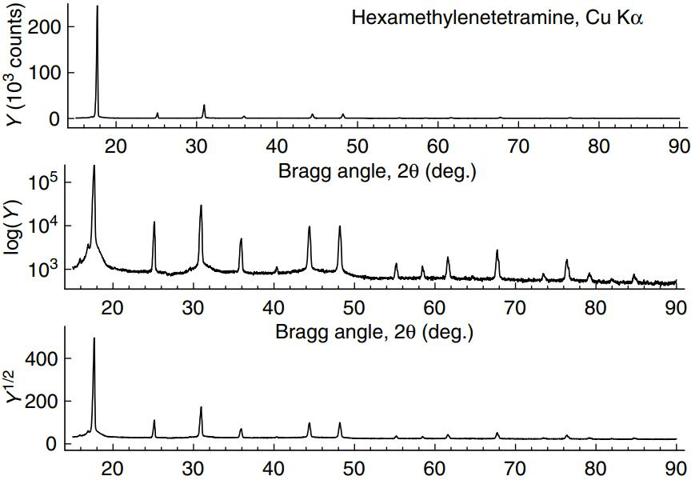

## **第三章   X-射线衍射基础**

## **3  X-射线衍射基础**

——X射线衍射的表示

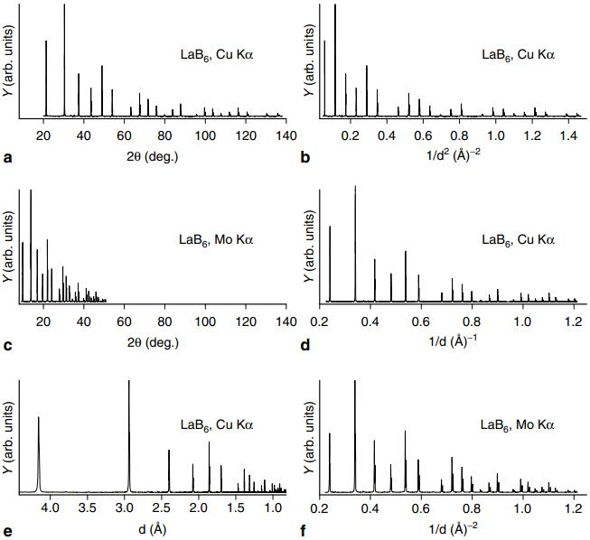

λ-2θ

## **第三章   X-射线衍射基础**

## **3  X-射线衍射基础**

——X射线衍射的表示

### **数据格式和origin画图基础**

### **raw数据**

### **格式转换工具**

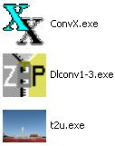

### **xy数据格式**

### **PS美化**

### **origin作图**

## **第三章   X-射线衍射基础**

## **3  X-射线衍射基础**

——X射线衍射的表示

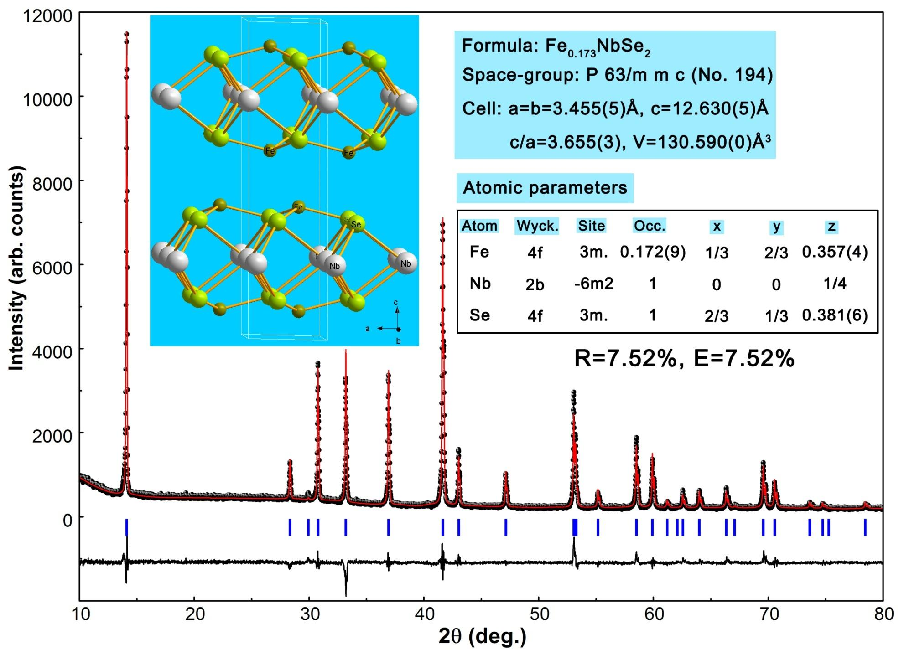

## **第三章   X-射线衍射基础**

## **3  X-射线衍射基础**

——X射线衍射的表示

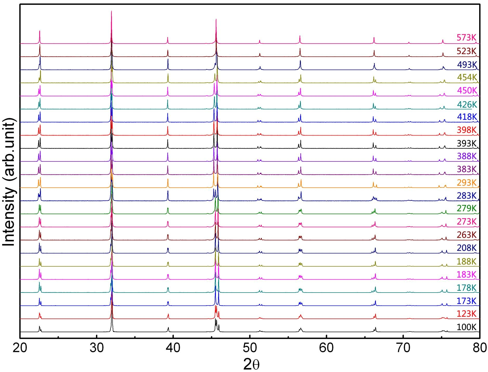

## **第三章   X-射线衍射基础**

## **3  X-射线衍射基础**

——X射线衍射的表示

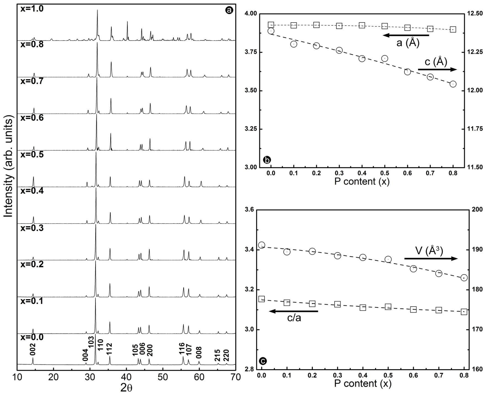

## **第三章   X-射线衍射基础**

## **3  X-射线衍射基础**

——X射线衍射的表示

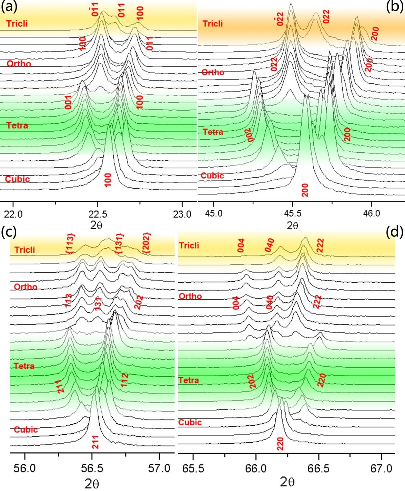

## **第三章   X-射线衍射基础**

## **3  X-射线衍射基础**

——X射线衍射花样特征

**峰位**

单胞大小、仪器零点、波长等

**衍射**

**花样**

**衍射峰**

**峰强**

原子位置、占有率、温度因子、择优取向、吸收效应等

**峰型**

结晶度、晶粒大小、应力、缺陷、衍射几何等

**背底**

空气散射、探测器噪声等

## **第三章   X-射线衍射基础**

## **3  X-射线衍射基础**

——X射线衍射的峰位

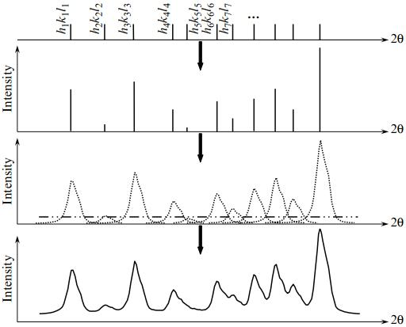

peak positions

intensity

profile

and bg

## **第三章   X-射线衍射基础**

## **3  X-射线衍射基础**

——X射线衍射的峰位

Bragg衍射：2dsinθ=nλ

θ-d-λ间的关系

zero offset→仪器对中

axis divergence→用较小的Div. slit

**系统误差**

asymmetric→用较小的receiving slit

absorption effect→大功率衍射仪

sample displacement→样品偏离衍射轴

## **第三章   X-射线衍射基础**

## **3  X-射线衍射基础**

——X射线衍射的峰位

### **峰位—晶格常数**

triclinic：a≠b≠c，α≠β≠γ≠90°，一般公式

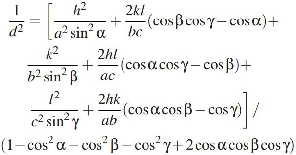

## **第三章   X-射线衍射基础**

## **3  X-射线衍射基础**

——X射线衍射的峰位

### **峰位—zero offset**

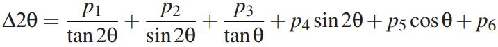

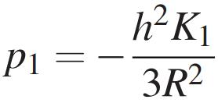

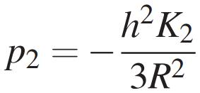

### **axial divergence**

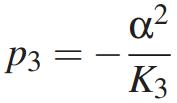

### **聚焦圆-平面样品**

### **曲率差异**

### **常忽略**

### **↓ Div. slit**

## **第三章   X-射线衍射基础**

## **3  X-射线衍射基础**

——X射线衍射的峰位

### **峰位—zero offset**

### **吸收效应**

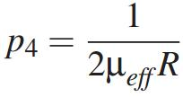

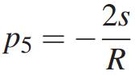

### **zero shift**

### **transparency**

### **shift**

### **specimen**

### **displacement**

## **第三章   X-射线衍射基础**

## **3  X-射线衍射基础**

——X射线衍射的峰位

### **峰位—zero offset**

## **第三章   X-射线衍射基础**

## **3  X-射线衍射基础**

——X射线衍射的峰宽

峰型——Peak shape function

### **仪器**

### **展宽函数**

### **光源**

### **发散度**

### **样品**

### **晶粒**

### **背底函数**

### **应力**

## **第三章   X-射线衍射基础**

## **3  X-射线衍射基础**

——X射线衍射的峰宽

峰型——Peak shape function

### **hkl衍射强度**

### **背底**

### **峰型函数**

## **第三章   X-射线衍射基础**

## **3  X-射线衍射基础**

——X射线衍射的峰宽

峰型——Peak shape function

### **Gaussian**

## **第三章   X-射线衍射基础**

## **3  X-射线衍射基础**

——X射线衍射的峰宽

峰型——Peak shape function

### **Lorentz**

## **第三章   X-射线衍射基础**

## **3  X-射线衍射基础**

——X射线衍射的峰宽

峰型——Peak shape function

### **Pseudo-Voigt**

## **第三章   X-射线衍射基础**

## **3  X-射线衍射基础**

——X射线衍射的峰宽

峰型——Peak shape function

### **Pearson-VII**

## **第三章   X-射线衍射基础**

## **3  X-射线衍射基础**

——X射线衍射的峰宽

峰型——Peak shape function

### **Pearson-VII**

## **第三章   X-射线衍射基础**

**3  X-射线衍射基础**

——X射线衍射的峰宽

峰型——Peak shape function

其中，半高宽(FWHM, peak full width at half maximum)为

Gaussian部分

Lorentz部分

## **第三章   X-射线衍射基础**

**3  X-射线衍射基础**

——X射线衍射的峰宽

峰型——Peak shape function

Lorentz部分

microstrain

isotropic broadening

instrument

boradening

crystal size

anisotropic broadening

## **第三章   X-射线衍射基础**

## **3  X-射线衍射基础**

——X射线衍射的峰宽

峰型——Peak shape function

## **第三章   X-射线衍射基础**

**3  X-射线衍射基础**

——X射线衍射的峰宽

峰型——Peak shape function

**峰的不对称性**

**仪器垂直方向存在发散度，仪器存在衍射像散**

低角区的峰明显宽于高角区

<20°时尤为明显

使用较小的Soller slit

## **第三章   X-射线衍射基础**

## **3  X-射线衍射基础**

——X射线衍射的峰宽

峰型——Peak shape function

### **峰的不对称性**

### **选用较小的Soller slit只能减弱峰的不对称性，不能消除！**

### **校正**

## **第三章   X-射线衍射基础**

## **3  X-射线衍射基础**

——X射线衍射的峰强

## **第三章   X-射线衍射基础**

**3  X-射线衍射基础**

——X射线衍射的峰强

Multiplicity

Polarization

Preferred orientation

scale factor

Lorentz

Absorption

Extinction

Structure facotor

## **第三章   X-射线衍射基础**

## **3  X-射线衍射基础**

——X射线衍射的峰强

标度因子 Scale factor

### **观察的积分强度 / 绝对计算强度**

### **单胞内所有原子在各方向上的总衍射强度**

### **给定材料在给定实验条件下得到的标度因子是恒定的**

### **是定量相分析的基础**

## **第三章   X-射线衍射基础**

## **3  X-射线衍射基础**

——X射线衍射的峰强

多重因子 Multiplicity

### **对称性相同的原子在相同的衍射角下具有相同的衍射强度！**

### **正交晶系**

### **多重因子是对称性和(hkl)的函数！**

## **第三章   X-射线衍射基础**

## **3  X-射线衍射基础**

——X射线衍射的峰强

Lorentz-polarization因子

### **源于有限的倒易点数 和 有限厚度的Ewald球**

### **Debye环半径的可变性**

## **第三章   X-射线衍射基础**

## **3  X-射线衍射基础**

——X射线衍射的峰强

Absorption 吸收效应

### **表征样品对X射线的吸收能力**

## **第三章   X-射线衍射基础**

## **3  X-射线衍射基础**

——X射线衍射的峰强

Preferred orientation 择优取向

### **March-Dollase函数**

## **第三章   X-射线衍射基础**

## **3  X-射线衍射基础**

——X射线衍射的峰强

Preferred orientation 择优取向

## **第三章   X-射线衍射基础**

## **3  X-射线衍射基础**

——X射线衍射的峰强

Extinction factor 动力学消光效应

### **在同一晶粒内，二次散射减弱探测强度**

### **不同晶粒内的多重散射减弱观察强度**

## **第三章   X-射线衍射基础**

## **3  X-射线衍射基础**

——X射线衍射的峰强

Structure factor 结构因子

### **原子总数**

### **占有率**

### **衍射晶面**

### **温度因子**

### **原子散射因子**

### **原子坐标**

## **第三章   X-射线衍射基础**

**3  X-射线衍射基础**

——X射线衍射的峰强

Occupation factor 占有率

0≤g≤1

**元素替代：**

占有率的转换：

O=g×M/m

Mg和B同时占据8e位置，且占有率分别为：80%，20%

OMg=0.8×16/8=1.6

OB=0.2×16/8=0.4

## **第三章   X-射线衍射基础**

**3  X-射线衍射基础**

——X射线衍射的峰强

Temperature factor 温度因子

T>T0时原子偏离平衡位置的振动(声子色散)，称为原子位移参数(atomic displacement parameters)。

**各向同性**

**各向异性**

## **第三章   X-射线衍射基础**

**3  X-射线衍射基础**

——X射线衍射的峰强

Temperature factor 温度因子

过渡金属：B ≈ 0.5-1 Å

无机化合物：B ≈ 1-3 Å

有机物：B ≈ 3-10 Å

## **第三章   X-射线衍射基础**

## **3  X-射线衍射基础**

——X射线衍射的峰强

Atomic scattering factor 原子散射因子

### **取决于电子密度的径向分布**

## **第三章   X-射线衍射基础**

## **3  X-射线衍射基础**

——X射线衍射的峰强

Lattice absence 点阵消光

## **第三章   X-射线衍射基础**

## **3  X-射线衍射基础**

——X射线衍射的峰强

Systmatic absence 系统消光

## **第三章   X-射线衍射基础**

## **3  X-射线衍射基础**

——X射线衍射的峰强

**常见结构的结构因子**

- **体心立方：取原点(0,0,0)和体心(0.5,0.5,0.5)，则结构因子为**

0，当(h+k+l)=奇数

4f2，当(h+k+l)=偶数

**BCC → FCC**

## **第三章   X-射线衍射基础**

## **3  X-射线衍射基础**

——X射线衍射的峰强

**常见结构的结构因子**

- **面心立方：取原点(0,0,0)和面心(0.5,0,0.5), (0.5,0.5,0), (0,0.5,0.5)，则结构因子为**

0，当(h,k,l)奇偶混合

16f2，当(h,k,l)全奇全偶

FCC → BCC

## **第三章   X-射线衍射基础**

## **3  X-射线衍射基础**

——X射线衍射的峰强

**常见结构的结构因子**

- **六角密排结构：取原点(0,0,0)和(1/3,1/3,1/2)，结构因子为**

0，当(h+2k)=3n, l为奇数

4f2，当(h+2k)=3n, l为偶数

3f2，当(h+2k)=3n+1或3n+2, l为奇数

f2，当(h+2k)=3n+1或3n+2, l为偶数