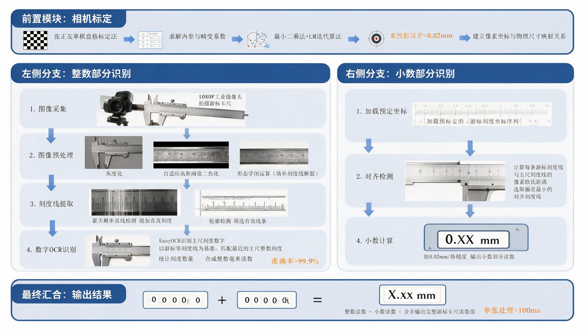
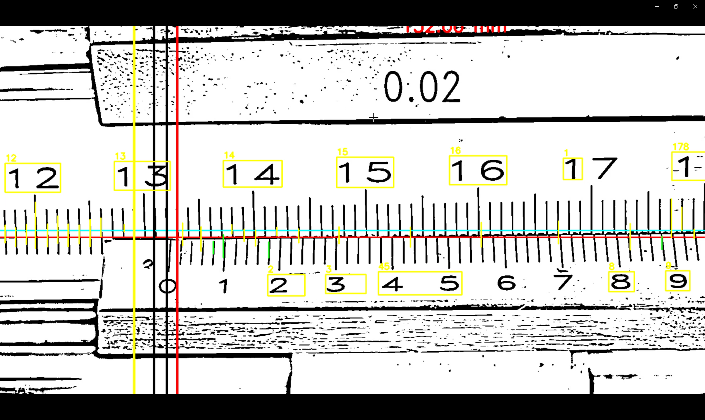
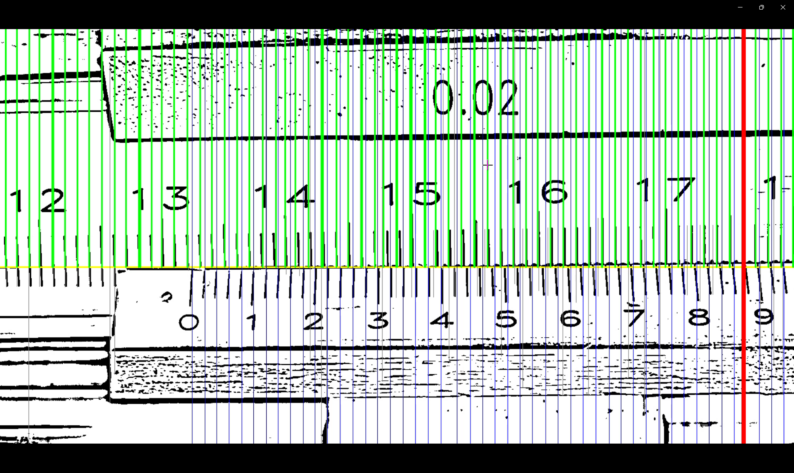
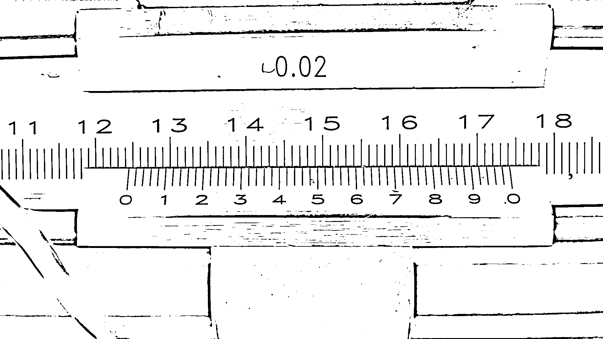
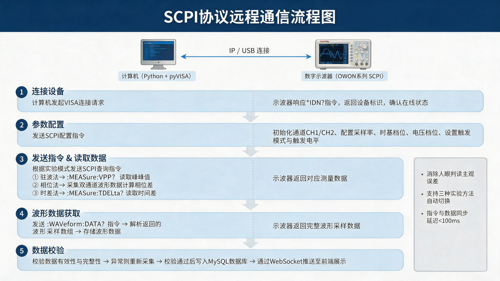
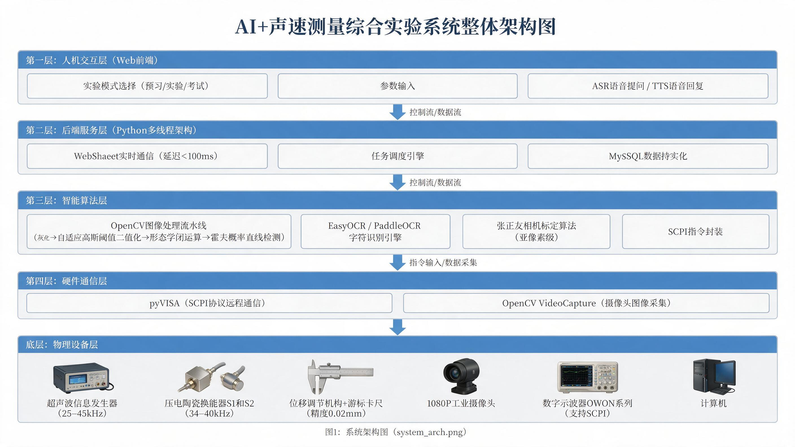

# AI+声速测量综合实验系统——基于机器视觉与SCPI协议的智能物理实验教学平台

> **第十八届（2025年）北京市大学生物理实验竞赛 · 参赛项目说明书**
>
> **参赛题目：** ☑ 题目7：AI+物理实验

---

## 目录

1. [设计原理与方法](#一设计原理与方法)
2. [实验仪器与装置](#二实验仪器与装置)
3. [数据测量与分析](#三数据测量与分析)
4. [结论](#四结论)
5. [项目创新与特色](#五项目创新与特色)
6. [制作成本](#六制作成本明细)

---

## 一、设计原理与方法

声速测量实验要求学生掌握驻波法、相位法与
时差法三种经典原理及不确定度分析方法。然而传统实验面临三大痛点：目视读数
主观误差大（游标卡尺视差与示波器波形极值判断依赖经验，B类不确定度达
0.1~0.2 mm）、师资覆盖不足（1名教师指导30~40名学生，难以一对一指导）、
数据管理低效（纸质报告批阅耗时，学生存在数据造假现象）。本项目将机器视觉、
SCPI协议远程通信与大语言模型引入声速测量实验，构建"AI+声速测量综合实验
系统"，实质性提升测量精度与教学深度。

### 1.1 物理原理

声波在理想气体中的传播速度为：

$$v = \sqrt{\frac{\gamma RT}{\mu}}$$

其中 $\gamma$ 和 $\mu$ 分别为气体的比热容比和摩尔质量，$T$ 为绝对温度，
$R$ 为普适气体常数。在温度为 $t\;(^\circ\mathrm{C})$ 的干燥空气中，
声速理论值由下式计算：

$$v = 331.5 + 0.6t \quad (\mathrm{m/s})$$

### 1.2 三种测量方法原理

**驻波法（共振干涉法）：** 发射换能器S1发出超声波，接收换能器S2表面
反射形成驻波，合成波振幅随距离按 $\cos(2\pi x/\lambda)$ 周期性变化，相邻
振幅极大值间距为 $\lambda/2$。传统痛点：手动调节鼓轮时人眼难以实时捕捉
振幅最大值，常因调节过快错过极值点。

**相位法（李萨如图法）：** 接收波与发射波之间存在相位差
$\theta=2\pi\Delta x/\lambda$，示波器X-Y模式下李萨如图形经历"椭圆→直线
→椭圆"的周期性变化，相邻两次相同图形状态对应位移差为 $\lambda$。
传统痛点：图形渐变过程人眼难以确定标准直线状态，观测-记录存在反应延迟。

**时差法：** 将连续波调制为脉冲波，通过测量声波在固定距离 $L$ 内的
传播时间 $t$，由 $v=L/t$ 直接计算声速，是三种方法中精度最高的验证性方案。
传统局限：目视读取示波器时间刻度受限于屏幕像素，距离与时间均需人工读数。

### 1.3 AI技术路径设计

#### 1.3.1 机器视觉自动读数

部署1080P工业摄像头采集游标卡尺图像，设计双分支并行识别算法（见图1）：**整数部分**经灰度化、自适应高斯阈值二值化、
形态学闭运算、霍夫概率直线检测提取垂直刻度线，EasyOCR识别主尺数字，以游标
零线为基准匹配最近整数刻度合成毫米读数，准确率超99.9%；**小数部分**
加载预设游标刻度坐标序列，计算与主尺刻度的像素欧氏距离，选取偏差最小的
对齐刻度线，按0.02 mm/格输出小数读数。采用张正友单棋盘格标定法求解内参与
畸变系数，通过最小二乘法与LM迭代最小化重投影误差（$<0.02$ mm），单张处理
耗时 $<100$ ms。

**图1：游标卡尺机器视觉自动读数流程图**

| 整数部分零刻度线识别 | 游标卡尺与主刻度线对齐部分识别 | 处理后的边缘线图 |
|:---:|:---:|:---:|
|  |  |  |

**图2：游标卡尺自动读数关键步骤效果图**

#### 1.3.2 SCPI协议远程采集

通过IP/USB接口与数字示波器建立SCPI标准指令会话（见图3）：
1. 发起VISA连接，`*IDN?` 确认设备状态
2. 自动初始化通道、采样率、时基、电压档位与触发
3. 驻波法发送 `:MEASure:VPP?` 追踪振幅极大值，相位法采集双通道波形计算相位差，时差法发送 `:MEASure:TDELta?` 获取高精度时间差
4. `:WAVeform:DATA?` 获取波形数组并存储
5. 校验数据有效性后写入MySQL并通过WebSocket推送前端

SCPI自动采集消除了人眼判读主观误差，支持三种方法自动切换。

**图3：SCPI协议远程通信流程图**

#### 1.3.3 多线程协同架构

主线程与示波器子线程采用队列/管道交互，WebSocket长连接保障前后端实时通信
（延迟 $<100$ ms），实现三种实验方法的自动化数据获取与并行处理。

---

## 二、实验仪器与装置

### 2.1 硬件组成

本系统的硬件部分由三类设备构成。第一类是传统声速测量实验的核心装置，包括一台频率范围为 25~45 kHz 的超声波信号发生器，一组谐振频率在 34~40 kHz 之间的压电陶瓷换能器（含发射端 S1 和接收端 S2），以及一套精度为 0.02 mm、量程 200 mm 的位移调节机构，其上安装有游标卡尺用于读取距离。

第二类是我们新增的智能采集设备。一台 1080P 工业摄像头固定对准游标卡尺刻度面，负责实时拍摄并交由机器视觉算法完成自动读数；一台支持 SCPI 协议的 OWON 系列数字示波器通过 IP 或 USB 接口与计算机连接，实现波形的远程采集与控制。

第三类是作为计算平台的计算机，运行 Python 后端程序和 Web 前端界面，是整个系统的控制中枢。

**图4：系统整体架构图**

### 2.2 软件架构

采用四层分层解耦架构：

1. **人机交互层**：Web前端（TypeScript），支持预习/实验/考试模式选择、参数输入、ASR语音提问与TTS回复
2. **后端服务层**：Python多线程，包含WebSocket通信、任务调度、MySQL数据持久化
3. **智能算法层**：OpenCV图像处理流水线、EasyOCR/PaddleOCR字符识别、张正友相机标定、SCPI指令封装
4. **硬件通信层**：pyVISA（SCPI协议）+ OpenCV VideoCapture（摄像头采集）

---

## 三、数据测量与分析

实验条件：室温 $t=25.0\;^\circ\mathrm{C}$，谐振频率 $f=37.125$ kHz。
理论声速 $v_{\text{理论}}=331.5+0.6\times 25.0=346.5$ m/s。

> **图5：三种方法的示波器波形**（上：驻波法；中：相位法；下：时差法）
>
> *【待补充：三种方法的示波器波形截图】*
> - 上行——驻波法YT模式（CH1发射/CH2接收，振幅周期性变化）
> - 中行——相位法XY模式（李萨如图：椭圆→直线→椭圆）
> - 下行——时差法YT模式（发射/接收脉冲，标注 $\Delta t$）

### 3.1 驻波法测量数据

**表2：驻波法测量数据（AI自动采集）**

| 测量次数 $i$ | 振幅极大位置 $L_i$ (mm) | $\Delta L=L_{i+5}-L_i$ (mm) | $\lambda=2\Delta L/5$ (mm) |
|:---:|:---:|:---:|:---:|
| 1 | 12.34 | 46.58 | 9.316 |
| 2 | 21.66 | 46.62 | 9.324 |
| 3 | 30.98 | 46.54 | 9.308 |
| 4 | 40.30 | 46.60 | 9.320 |
| 5 | 49.62 | 46.56 | 9.312 |
| 6 | 58.92 | — | — |
| 7 | 68.28 | — | — |
| 8 | 77.52 | — | — |
| 9 | 86.90 | — | — |
| 10 | 96.18 | — | — |

波长平均值 $\bar{\lambda}=9.316$ mm。声速测量值：

$$v_{\text{驻波}}=\bar{\lambda}\cdot f=9.316\times 10^{-3}\times 37.125\times 10^3 =345.8\;\mathrm{m/s}$$

相对误差：$\varepsilon=|345.8-346.5|/346.5\times 100\%=0.20\%$。

### 3.2 相位法测量数据

**表3：相位法测量数据（AI自动采集）**

| 测量次数 $i$ | 同相位位置 $L_i$ (mm) | $\Delta L=L_{i+3}-L_i$ (mm) | $\lambda=\Delta L/3$ (mm) |
|:---:|:---:|:---:|:---:|
| 1 | 10.52 | 27.96 | 9.320 |
| 2 | 19.84 | 27.90 | 9.300 |
| 3 | 29.16 | 28.02 | 9.340 |
| 4 | 38.48 | — | — |
| 5 | 47.74 | — | — |
| 6 | 57.18 | — | — |

波长平均值 $\bar{\lambda}=9.320$ mm。声速测量值 $v_{\text{相位}}=346.0$ m/s，
相对误差 0.14%。

### 3.3 时差法验证数据

**表4：时差法验证数据（SCPI高精度采集）**

| 次数 | $L$ (mm) | $t$ ($\mu$s) | $v=L/t$ (m/s) |
|:---:|:---:|:---:|:---:|
| 1 | 50.00 | 144.2 | 346.7 |
| 2 | 75.00 | 216.4 | 346.6 |
| 3 | 100.00 | 288.5 | 346.6 |
| 4 | 125.00 | 360.7 | 346.5 |
| 5 | 150.00 | 432.9 | 346.5 |

时差法平均声速 $v_{\text{时差}}=346.6$ m/s，相对误差 0.03%。

三种方法的声速测量值均与理论值高度吻合（相对误差均 $<0.5\%$），时差法作为
基准方案误差仅0.03%。

### 3.4 AI方案与传统方案对比

**表5：AI智能实验方案与传统实验方案对比**

| 对比维度 | 传统实验方案 | AI智能实验方案 |
|:---|:---|:---|
| 读数精度 | 游标卡尺目视视差 0.1~0.2 mm；示波器波形判断主观性强 | 机器视觉自动读数 0.02 mm，亚像素标定误差 $<0.02$ mm；SCPI自动采集消除主观误差 |
| 教学指导 | 1名教师指导30~40名学生，一对一指导难以实现 | 7×24小时AI助教一对一指导，实时纠错与答疑 |
| 数据处理 | 纸质报告人工批阅耗时小时级，难以量化教学效果 | 实时电子化存储，秒级完成统计分析，支持高频错误定位 |
| 考核公平性 | 人工打分主观偏差，过程性评价难以实施 | 自动打分标准统一，全程留痕可追溯 |

---

## 四、结论

本项目成功构建了AI+声速测量综合实验系统，实现了三种经典声速测量方法的
智能化升级：

1. **测量精度显著提升**：机器视觉自动读数将游标卡尺B类不确定度
   从0.1~0.2 mm降至0.02 mm以内；SCPI远程采集消除了示波器波形人眼
   判读的主观误差。三种方法相对误差均 $<0.5\%$，时差法作为基准方案
   误差仅0.03%。

2. **教学效率大幅提高**：AI系统提供7×24小时一对一指导，
   覆盖预习—实验—考试全流程。基于大语言模型与实验知识库，系统构建
   差异化AI行为策略：预习模式主动引导操作流程并设"理论达标→实践
   解锁"机制；实验模式后台实时比对采集数据与学生输入值，偏差过大时
   即时提醒纠正；考试模式全程静默考核、自动评分。解决了1名教师指导
   30~40名学生的师资不足问题。

3. **数据管理实现数字化**：实验数据实时电子化存储，支持秒级统计
   分析与可视化Dashboard展示，高频错误定位为教学改进提供量化依据，
   全程留痕可追溯，支持过程性与结果性评价的有机结合。

---

## 五、项目创新与特色

### 5.1 技术创新：多模态融合

1. **首创将机器视觉集成于物理实验教学**：首次将OpenCV图像处理、
   OCR字符识别、张正友相机标定等技术系统性地应用于大学物理实验教学，
   实现游标卡尺亚像素级自动读数（误差 $<0.02$ mm），整数读数准确率
   超99.9%。

2. **SCPI协议驱动的自动化数据采集**：通过工业标准SCPI协议实现
   计算机与示波器的远程通信，支持驻波法幅值追踪、相位法李萨如图拟合、
   时差法高精度计时三种模式的自动切换，消除人眼判读误差。

3. **多线程+WebSocket实时交互架构**：Python多线程后端与WebSocket
   长连接实现示波器采集与前端展示的并行处理，指令与数据同步延迟低于
   100 ms。

### 5.2 教学模式创新：差异化策略

1. **首创"理论达标→实践解锁"机制**：学生需通过理论测试后方
   可进入实验操作，杜绝"照搬步骤、不理解原理"现象。

2. **AI行为随场景动态调整**：预习模式主动引导操作流程；实验模式
   被动答疑与实时纠错；考试模式静默监考，实现个性化学习路径与差异化
   教学支持。

3. **首创构建实验全流程数字化档案**：每位学生的操作数据、测量结果、
   AI纠错记录自动归档，支持设备级、班级级、校级多维度数据统计与可视化，
   高频错误统计帮助教师精准定位学生普遍薄弱知识点（如李萨如图形判断、
   游标读数规则等），实现教学问题的精准诊断与持续改进。

---

## 六、制作成本（明细）

**表6：制作成本明细（单套系统估算）**

| 序号 | 名称 | 数量 | 单价（元） |
|:---:|:---|:---:|:---:|
| 1 | 超声波信号发生器 | 1台 | 【待补充】 |
| 2 | 压电陶瓷换能器（发射+接收） | 1组 | 【待补充】 |
| 3 | 位移调节机构（含游标卡尺） | 1套 | 【待补充】 |
| 4 | 1080P工业摄像头 | 1个 | 【待补充】 |
| 5 | 数字示波器（支持SCPI） | 1台 | 【待补充】 |
| 6 | 计算机 | 1台 | 【待补充】 |
| 7 | 软件开发（Python后端+Web前端） | 1套 | 【待补充】 |
| **合计** | | | **【待补充】** |
